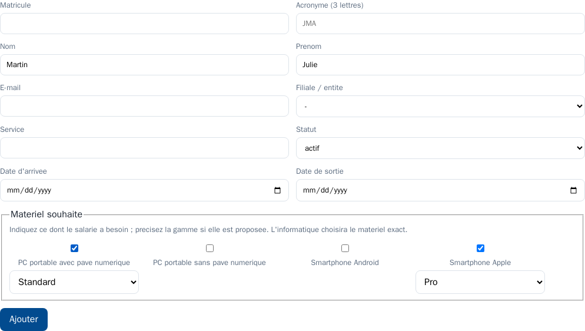
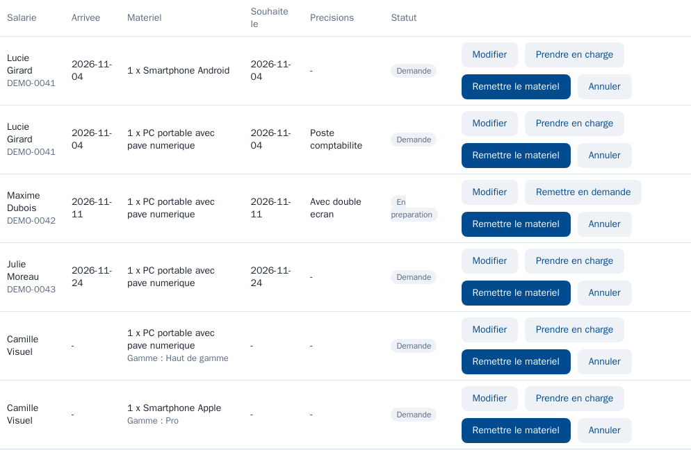
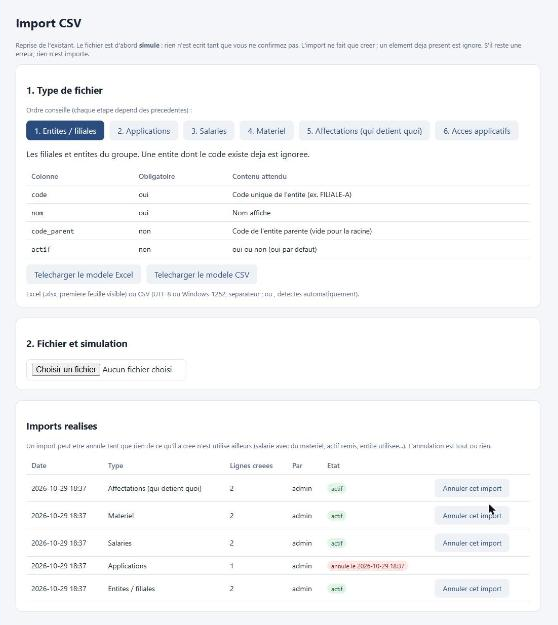

# Kikan

[](https://github.com/GabrielFotoPoto/kikan-asset-tracker/actions/workflows/ci.yml)

**Kikan** (機器管理, *kiki-kanri*, « gestion des équipements ») est une application de
**suivi des actifs** (PC, smartphones...) par utilisateur et par entité, avec **remise et
restitution de matériel signées et scellées** (sans papier), import de l'existant, reporting
et gestion des accès applicatifs.

Elle soutient plusieurs contrôles de l'ISO/IEC 27001:2022 :
A.5.9 (inventaire des actifs), A.5.10 (usage acceptable), A.5.11 (restitution des actifs)
et A.5.18 (droits d'accès).

> Remarque : un logiciel n'est pas « certifié ISO 27001 ». Kikan *facilite* la conformité du
> SMSI d'une organisation, il ne la remplace pas.

## Fonctionnalités (v0.1)

- **Cycle de vie du salarié** : formulaire d'entrée (RH), départ avec génération automatique de
  la liste du matériel à récupérer, passage automatique en « sorti » une fois tout rendu.
- **Remise signée** : génération d'un accusé PDF (matériel + charte informatique annexée), **signature manuscrite
  de l'employé sur tablette** (doigt, stylet ou souris), puis **scellement PAdES** (certificat auto-signé de
  l'organisation, horodatage RFC 3161 optionnel). Document infalsifiable et vérifiable.
- **Restitution signée** (A.5.11), avec la même signature manuscrite, conduite par l'informatique ou les RH.
- **Multi-entités / filiales** : rattachement des salariés, données filtrables par entité.
- **Accès applicatifs** (A.5.18) : catalogue d'applications, attribution par salarié avec note
  de niveau (ex. administrateur, « mêmes droits que... »).
- **Import CSV** de l'existant (entités, applications, utilisateurs, matériel, affectations,
  accès), avec prévisualisation et rapport d'erreurs par ligne.
- **Reporting** « qui détient quoi » à l'instant T, export **CSV** et **PDF**.
- **Statistiques** de parc (modèles les plus distribués, répartition, taux d'équipement,
  renouvellements à venir, âge moyen).
- **Rétention RGPD** paramétrable (durée de conservation et délai de grace), avec prévisualisation, quarantaine des PDF du partage avant
  suppression définitive et liste des documents à supprimer dans la GED : voir [docs/RGPD.md](docs/RGPD.md).
- **Authentification et rôles** : RH, informatique, lecture seule.

## Pile technique

- **Front** : React (Vite), servi par Nginx (reverse-proxy `/api`).
- **Back** : FastAPI (Python), SQLModel.
- **Base** : PostgreSQL.
- **Signature PDF** : pyHanko (PAdES) ; **génération PDF** : ReportLab.
- Déploiement **on-premise**, entièrement conteneurisé (`docker compose`).

## Démarrage rapide

Prérequis : Docker et Docker Compose.

```bash
cp .env.example .env        # puis renseigner POSTGRES_PASSWORD et KIKAN_SECRET_KEY
docker compose up --build
```

- Interface : **https://localhost:3443** (certificat auto-signé : avertissement du navigateur à accepter
  en local). Le port `http://localhost:3000` redirige vers HTTPS.
- API en direct (développement, machine locale uniquement) : http://localhost:8080
  (documentation interactive : http://localhost:8080/docs, masquée en production).

### Premier compte

Au premier démarrage, un compte **informatique** est créé (identifiant `admin` par défaut). Son mot de passe est
**aléatoire** : il est affiché une seule fois dans les journaux.

```bash
docker compose logs api | grep "COMPTE INITIAL"
```

Connectez-vous, puis changez-le depuis **Mon compte** et créez des comptes nominatifs. Vous pouvez aussi fixer
vous-même `KIKAN_ADMIN_USER` et `KIKAN_ADMIN_PASSWORD` dans `.env` avant le premier démarrage.

### Mot de passe perdu ou oublié

- **Libre-service** : l'écran de connexion propose « Mot de passe oublié ? » dès que le serveur e-mail est actif
  (Paramétrage > E-mails) et que `KIKAN_PUBLIC_URL` est renseignée. L'utilisateur reçoit, à l'adresse de son compte, un lien
  valable 30 minutes et à usage unique ; le nouveau mot de passe révoque ses sessions ouvertes. Le message affiché est le même
  que le compte existe ou non, et les demandes sont limitées. Les comptes Microsoft 365 n'ont pas de mot de passe local.
- **Par un administrateur** : page Comptes > « Réinitialiser le mot de passe » (mot de passe provisoire affiché une fois).
- **Plus aucun administrateur ne peut se connecter** : depuis le serveur,
  `docker compose exec api python -m app.reset_admin <identifiant> [--activer]` génère un mot de passe provisoire
  (changement imposé à la première connexion ; `--activer` réactive un compte désactivé).

> **Sécurité** : `KIKAN_SECRET_KEY` (clé de signature des sessions, 32 caractères minimum) et `POSTGRES_PASSWORD`
> sont à définir dans `.env`, qui ne doit jamais être commité. Avec `KIKAN_ENV=production`, l'application refuse
> de démarrer sans clé solide. Voir [SECURITY.md](SECURITY.md) pour la liste de contrôle de mise en production,
> les risques acceptés et les tests de sécurité.

### Tablette de signature sur le réseau local

Par défaut l'interface n'est publiée que sur la machine locale. Pour l'ouvrir au réseau de l'organisation,
définir dans `.env` `KIKAN_BIND` (adresse IP du serveur) et `KIKAN_TLS_SAN` (ex. `DNS:kikan.exemple.local,IP:192.168.1.10`)
avant le premier démarrage, ou monter le certificat de l'organisation dans le volume `kikan_webcerts`.

## Rôles

| Rôle | Droits |
|---|---|
| **informatique** | Tout : matériel, remises, restitutions, signatures, entités, import, paramétrage, RGPD, comptes, journal d'audit. |
| **rh** | Cycle de vie des salariés (entrées, départs), restitutions, accès applicatifs, besoins de matériel. Lecture du reste. |
| **lecture** | Consultation et export uniquement. |

> Cible v0.2 : authentification **SSO Microsoft 365 (Entra ID)** avec comptes nominatifs,
> réservée aux groupes `Kikan-IT` (informatique) et `Kikan-RH` (rh).

## Signature manuscrite

À la remise, l'informatique ouvre l'**écran de signature** (bouton « Signer » de la page Remises ; « Restituer et
signer » pour une sortie), pensé pour une tablette. L'écran affiche le récapitulatif (salarié, matériel, charte), le
nom du salarié **repris de sa fiche et non modifiable**, une case d'acceptation obligatoire et le cadre de signature.
La signature est insérée dans le PDF, avec le nom, la date et l'heure (UTC) et le compte qui conduit la remise
(témoin), puis le tout est scellé.

- L'image est traitée comme une donnée non fiable : PNG uniquement, taille et dimensions bornées, trace réel exigé
  (signature vide ou réduite à un point refusée), protection contre les images piégées, ré-encodage sans métadonnées.
- La signature n'est conservée **que dans le PDF scellé** (donc supprimée avec lui par la purge RGPD) ; la base ne
  garde que des empreintes, le nombre de traits et la durée du tracé comme éléments de preuve.
- Une remise ne se signe qu'une seule fois.
- Par défaut la signature manuscrite est **obligatoire**. `KIKAN_SIGNATURE_MANUSCRITE_OBLIGATOIRE=false` autorise une
  simple confirmation (méthode `confirmation`, moins probante).

## Chartes informatiques

La charte est un **fichier déposé par l'informatique** (page **Chartes**) : document **Word (.docx)**, **PDF** ou
**Markdown**. Elle est **globale** (toutes les entités) ou **propre à une entité** ; une entité sans charte propre
hérite de celle de son entité parente, puis de la charte globale. Pour la mettre à jour, il suffit de déposer le
nouveau fichier : l'ancienne version est **archivée et conservée** (jamais supprimée), les documents déjà signés ne
changent pas.

- À la création d'une remise, la charte applicable au salarié est **jointe d'office** (un autre choix ou « aucune
  charte » est possible). À la signature, le serveur relit la charte, contrôle son empreinte et l'**annexe au PDF
  avant le scellement** ; la version et l'empreinte sont enregistrées comme preuve. L'écran de signature affiche la
  charte page par page.
- Les fichiers sont conservés dans le stockage choisi (volume, SMB ou WebDAV), avec le fichier d'origine.
- Un fichier déposé est une donnée non fiable : il est reconstruit en PDF propre (sans JavaScript, lien, action ni
  annotation) et contrôlé par un second moteur. Le Markdown accepte titres, listes, **gras** et *italique*.
- Les documents Word sont convertis par un **service isolé** (`converter`, LibreOffice) sans accès à Internet. S'il
  est arrêté, le dépôt Word est refusé avec un message clair (PDF et Markdown restent possibles). Pour s'en passer :
  retirer le service `converter` de `docker-compose.yml` et vider `KIKAN_WORD_CONVERTER_URL`.
- Limites : `KIKAN_MAX_CHARTE_MB` (10 Mo), 60 pages. Le texte Markdown est rendu avec les polices standard du PDF
  (lettres accentuées courantes, pas les emojis).

## Connexion Microsoft 365 (option)

La connexion par Microsoft 365 (Entra ID) est **facultative** : tant qu'elle n'est pas activée, Kikan fonctionne en connexion
locale. Procédure complète dans [`docs/SSO.md`](docs/SSO.md).

- **Principe** : OpenID Connect (code d'autorisation avec PKCE) côté serveur, **un seul tenant**, MFA du tenant. Le rôle vient des
  **rôles d'application** Entra `Kikan.IT` et `Kikan.RH` (noms modifiables), attribués à vos groupes ; toute autre personne est refusée.
- **Comptes** : nominatifs, créés à la première connexion d'un membre autorisé (identifiant stable Entra, jamais l'e-mail), rôle
  **resynchronisé à chaque connexion**. Un compte local existant se lie explicitement (page Comptes), jamais par e-mail.
- **Configuration** : `.env` (`KIKAN_PUBLIC_URL`, `KIKAN_SSO_TENANT_ID`, `KIKAN_SSO_CLIENT_ID`, `KIKAN_SSO_CLIENT_SECRET`) ; le secret
  n'est jamais stocké en base ni affiché. Puis **Paramétrage, Authentification** : test de la configuration, test de connexion,
  réglages (mode de connexion par mot de passe, création automatique des comptes, MFA exigée, noms des rôles, durée de session) et activation.
- **Garde-fous** : l'activation exige un test de connexion réussi de l'administrateur qui l'active et au moins un **compte local de
  secours** (case « Secours » de la page Comptes). Désactiver le SSO rend aussitôt la connexion par mot de passe.
- **Session** : durée réglable de 30 minutes à 12 heures (toutes connexions). Retirer quelqu'un d'Entra n'interrompt pas sa session
  ouverte (limite documentée) ; désactiver son compte dans Kikan la coupe immédiatement.

## Comptes

La page **Comptes** (informatique) gère les comptes des équipes informatique, RH et lecture seule (les salariés
n'ont pas de compte : ils signent sur la tablette). Comptes **nominatifs** : identifiant (3 à 64 caractères, minuscules,
chiffres et `. _ - @`, unique sans tenir compte de la casse, non modifiable), nom, e-mail, rôle.

- **Création et réinitialisation** : le serveur génère un **mot de passe provisoire** (`XXXX-XXXX-XXXX-XXXX`), affiché
  **une seule fois** à l'administrateur (jamais relu, jamais journalisé). La personne doit le remplacer à sa première
  connexion : tant que ce n'est pas fait, un écran dédié est seul accessible et le serveur refuse tout le reste.
- **Sessions révoquées aussitôt** quand le mot de passe change ou est réinitialisé, quand le rôle change ou que le compte
  est désactivé.
- **Désactiver, réactiver, changer le rôle** ; pas de suppression (les journaux d'audit citent l'identifiant). On ne peut
  ni désactiver son propre compte ni retirer le dernier compte informatique actif.
- La **dernière connexion** de chaque compte est affichée, pour repérer les comptes dormants.
- Le compte générique `admin` du premier démarrage se remplace par des comptes nominatifs, puis se désactive.

### Cloisonnement par entité

Les comptes **RH** et **lecture** sont **globaux** ou **limités à une ou plusieurs entités** (leurs sous-entités sont
incluses) ; les comptes **informatique** (administrateurs) voient toujours tout. Le filtrage est fait **côté serveur**
sur chaque lecture et chaque écriture : un élément hors périmètre est « introuvable » (404). Un nouveau compte RH ou
lecture n'a **aucun périmètre** tant qu'un administrateur n'en définit pas un. Les données sans entité ne sont visibles
que des comptes globaux ; les listes de suggestions (types, services, marques) et la charte globale restent communes.
Les pages d'administration (comptes, paramétrage, stockage, journal d'audit, RGPD, import) sont réservées à l'informatique.


*Captures réalisées avec des données de démonstration fictives.*

## Besoins de matériel

Les **RH** déclarent le matériel nécessaire à un salarié, typiquement à son arrivée (salarié au statut « prévu ») ;
l'**informatique** le prépare puis le remet. Page **Besoins** (lecture pour tous, saisie pour les RH et l'informatique).

- **Un besoin** : un salarié, un type de matériel (de la liste du Paramétrage : les RH ne créent pas de types), une quantité,
  des précisions courtes et une date souhaitée (par défaut, la date d'arrivée).
- **Quatre statuts** : `demande`, `en préparation`, `satisfait`, `annulé`. La RH peut modifier ou annuler tant que le besoin
  est en demande ; l'informatique le prend en charge, le remet en demande ou l'annule. **« Satisfait » ne s'obtient que par une
  remise** : à la création d'une remise, les besoins ouverts du salarié sont proposés (cochés d'office) et soldés avec elle.
- **Cloisonnement** : une RH ne voit et ne modifie que les besoins des salariés de son périmètre.
- **Tableau de bord** : compteur « Besoins à traiter ». **E-mail** (Paramétrage, onglet E-mails) : rappel hebdomadaire à
  l'informatique pour les arrivées proches dont le besoin n'est pas traité.
- Un salarié qui a des besoins ne se supprime pas ; la purge RGPD les supprime avec lui. Les créations, changements de statut et
  soldes sont tracés dans le journal d'audit (jamais le texte des précisions).






## Intégrations : API d'import et GLPI

**Paramétrage, onglet Intégrations** (informatique). Tout est facultatif.

- **API d'import par jetons** (`/api/v1`, documentation : [docs/API.md](docs/API.md)) : un outil externe envoie du matériel et
  des salariés vers Kikan avec un **jeton** (affiché une seule fois, empreinte seule conservée, expiration obligatoire, droits et
  périmètre limités, débit limité). Idempotente, avec simulation (`?dry_run=1`) et lots ; **jamais de suppression, jamais d'écrasement**,
  les éléments déjà connus (même numéro de série, matricule ou e-mail) sont **liés** et non dupliqués.
- **Connecteur GLPI** (documentation : [docs/GLPI.md](docs/GLPI.md)) : à la demande, Kikan **importe** ce qui existe dans GLPI après votre
  sélection (ordinateurs et téléphones avec leur **numéro de série**, utilisateurs) et **exporte** vers GLPI les salariés et leur
  matériel affecté avec les numéros de série (de quoi créer ensuite des tickets d'assistance). La source de vérité des salariés reste
  Kikan. Testé contre de vrais GLPI **10.0.28, 11.0.12 et 12.0.1** (API REST historique) ; jetons dans le `.env`, jamais affichés.


## E-mails : rappels et rapport mensuel

Kikan peut envoyer des e-mails automatiques par **le serveur SMTP de votre entreprise** (aucun serveur de messagerie n'est
embarqué). Tout est facultatif et désactivé par défaut : **Paramétrage, onglet E-mails** (informatique).

- **Serveur** : nom, port, sécurité (aucune pour un relais interne, STARTTLS ou SSL), identifiant éventuel, adresse d'expédition.
  Le **mot de passe SMTP**, s'il en faut un, se règle par la variable `KIKAN_SMTP_PASSWORD` du fichier `.env` : il n'est
  jamais stocké en base ni affiché. Une **adresse de liste** (ex. `informatique@...`) peut s'ajouter aux comptes destinataires.
- **Rappels automatiques** (un récapitulatif par personne et par jour, à l'heure choisie) : renouvellements de matériel
  (informatique et liste), départs à venir avec du matériel encore détenu, matériel non restitué après la date de sortie,
  besoins de matériel non traités pour des arrivées proches (informatique et liste).
  Un rappel déjà envoyé n'est renvoyé qu'à l'échéance de relance. Une RH ne reçoit que les salariés de son périmètre.
- **Rapport mensuel** : parc, remises et restitutions du mois, matériel non restitué, renouvellements ; envoyé à
  l'informatique et à la liste avec un lien vers les rapports (variable `KIKAN_PUBLIC_URL`). Une pièce jointe Excel ou PDF est
  possible mais désactivée par défaut, car rien de sensible ne doit circuler par e-mail sans nécessité.
- **Contrôles** : message de test, aperçu de ce qui serait envoyé, envoi immédiat des rappels ou du rapport, dernier résultat
  et dernière erreur. Les envois sont tracés dans le journal d'audit (jamais le contenu des messages).
- **Essayer sans risque** : `docker compose --profile mail-test up -d mailpit` lance un faux serveur de messagerie local
  (serveur `mailpit`, port `1025`, sécurité « aucune ») dont les messages se lisent sur http://127.0.0.1:8025 ; rien ne sort de
  la machine. Arrêt : `docker compose --profile mail-test rm -sf mailpit`.


## Modification et suppression

Les pages Entités, Utilisateurs, Matériel et Accès applicatifs (catalogue) offrent **Modifier** (formulaire
pré-rempli) et **Supprimer** (confirmation en deux temps). Principe : **ce qui a une histoire ne se supprime pas, on le
désactive ou on l'archive** (traçabilité ISO 27001).

| Élément | Suppression autorisée si | Sinon |
|---|---|---|
| Entité | aucun salarié, actif, application, charte ni entité fille | la désactiver |
| Salarié (informatique seule) | jamais d'affectation ni d'accès | statut « sorti » via la page Sorties ; effacement définitif par la purge RGPD |
| Actif | jamais remis | statut « réformé » |
| Application | aucun accès attribué | la désactiver |

Le refus indique précisément ce qui bloque (« utilisé par 3 salariés... »). Règles de cohérence : les statuts
« affecté » et « rendu » d'un actif viennent de la remise et de la restitution, jamais d'une saisie ; un salarié passe
« sorti » uniquement par le départ (restitution signée) et n'est pas réactivé ; renommer le code d'une entité met à
jour ses filiales ; les boucles de parenté, les codes, matricules, numéros de série et identifiants internes en double
sont refusés. Le journal d'audit conserve les **noms des champs modifiés**, jamais leurs valeurs.

## Saisie assistée du matériel

Dans le formulaire matériel, **Type, Marque et Modèle** (et **Service** sur la fiche salarié) proposent des suggestions pendant
la saisie : recherche partielle **insensible à la casse et aux accents** (« lenovo » trouve « Lénovo »), valeurs qui commencent
par la saisie d'abord, puis celles qui la contiennent, puis les plus utilisées, avec le nombre de matériels concernés.
Navigation au clavier (flèches, Entrée, Échap) et au doigt.

- Les **modèles sont filtrés par la marque choisie** ; si le type est renseigné, les modèles déjà vus avec ce type passent en premier
  (classement seulement, jamais un blocage).
- Une valeur **inédite** est acceptée et ajoutée au catalogue ; un rappel « Nouvelle marque » ou « Proche de Dell » s'affiche.
- **Graphie canonique** : à l'enregistrement (formulaire, API et import), une marque ou un modèle qui ne diffère d'une entrée
  existante que par la casse, les accents ou les espaces reprend la graphie la plus utilisée (la ponctuation reste significative :
  « T14 » et « T-14 » sont distincts). Les données déjà saisies ne sont pas modifiées : l'outil de fusion du Paramétrage sert à les nettoyer.

Le catalogue est déduit du matériel saisi (pas de table dédiée), donc toujours cohérent avec la fusion.

## Paramétrage

La page **Paramétrage** (informatique) regroupe :

- **Types d'actifs** et **services** : listes qui alimentent les menus du matériel et des fiches salariés (ajout,
  renommage, activation, suppression si inutilisé). Les listes sont **souples** : une valeur nouvelle saisie ou importée
  s'ajoute à la liste sans jamais bloquer, et une valeur qui ne diffère que par la casse reprend la graphie de la liste.
  Renommer met à jour tout le matériel ou toutes les fiches concernés.
- **Marques et modèles** : outil de **fusion** des variantes (Dell, DELL, Dell Technologies) vers un nom unique, avec
  détection des variantes probables, aperçu du nombre de matériels touchés et confirmation. Opération atomique, tracée.
- **Accès applicatifs dans l'accusé de remise** (option) : case à cocher « Inclure les accès applicatifs » dans l'onglet
  Modèle de PDF (désactivée par défaut). L'accusé comporte alors une section **Accès applicatifs accordés** (accès accordés sur
  des applications actives, avec leur niveau), **figée au moment de la signature**, et la déclaration signée le mentionne.
  L'écran de signature affiche la même liste et en transmet l'empreinte : si les accès changent entre l'affichage et la
  signature, celle-ci est refusée (rechargement), de sorte que le salarié signe exactement ce qu'il a vu. Le nombre d'accès et
  l'empreinte de la liste sont enregistrés avec la signature. Sans effet sur la restitution.
- **Modèle de PDF** : nom de l'organisation, **logo** (PNG ou JPEG, 300 Ko, 1000 x 400 px, ré-encodé par le serveur),
  mentions légales et pied de page, appliqués à l'accusé de remise, à l'accusé de restitution et au rapport PDF, avec un
  aperçu. Le modèle en vigueur est **figé dans chaque document signé** et son empreinte est enregistrée avec la
  signature : le modifier ne change aucun document existant.
- **État du scellement** (lecture seule) : certificat (sujet, validité, empreinte), autorité de temps, signature
  manuscrite obligatoire, stockage et limites. Ces réglages restent dans le déploiement (`.env`), car ils touchent à la
  valeur probante des documents.

Les chartes, les applications, le stockage, la rétention RGPD et les comptes ont leur propre page.

## Import de l'existant

Page **Import** (informatique) : choix du type de fichier, aide colonne par colonne, **modèle CSV téléchargeable**
(aussi dans [`import-modeles/`](import-modeles/)), puis dépôt du fichier.

1. Le fichier est d'abord **simulé** : rien n'est écrit. Le rapport indique les lignes lues, à créer, ignorées et en
   erreur (avec le numéro de ligne et le problème), et le détail ligne par ligne.
2. Le bouton **Importer pour de bon** n'est actif que si la simulation est sans erreur (**tout ou rien**). L'import
   réel traite exactement le fichier simulé (contrôle par empreinte SHA-256).
3. Les erreurs se téléchargent en CSV pour corriger le fichier source.

L'import **ne fait que créer** : un élément déjà présent (même code d'entité, matricule, application ou accès) est
ignoré, ce qui permet de rejouer un fichier sans doublon. Format : UTF-8 ou Windows-1252 (export Excel), séparateur
`;` ou `,` (détectés), dates `AAAA-MM-JJ`, booléens `oui/non`. Ordre conseillé : entités, applications, utilisateurs,
matériel, affectations, accès. Plafonds : `KIKAN_MAX_IMPORT_MB` (5 Mo), `KIKAN_MAX_IMPORT_ROWS` (20 000 lignes).
Chaque simulation et chaque import sont tracés dans le journal d'audit (type, compteurs, empreinte, sans contenu).
**Annuler un import** : chaque import réel est enregistré comme un lot (carte *Imports réalisés*, bouton *Annuler cet import*). L'annulation supprime
ce que l'import a créé, **tout ou rien**, et seulement si rien n'en dépend : salarié avec du matériel, des accès ou des besoins, actif remis, entité
utilisée par d'autres fiches, remise déjà signée ou restituée, élément lié à GLPI. Le refus indique ce qui bloque. Les actifs d'un import d'affectations
reprennent leur statut d'avant. Les imports de l'API et de GLPI ne sont pas concernés.



*Capture réalisée avec des données de démonstration.*
**Excel (.xlsx)** : la page Import accepte aussi un classeur, avec le même parcours (simulation, tout ou rien,
empreinte). Première feuille visible, en-têtes en ligne 1, lignes vides ignorées (les numéros de ligne du rapport restent ceux
du classeur), dates Excel et nombres convertis (un matricule 1001 reste « 1001 »). Les formules ne sont jamais évaluées : on lit
la valeur enregistrée par Excel, et une formule sans valeur enregistrée est signalée en erreur. Des **modèles Excel** (listes
déroulantes, colonnes au format texte, feuille d'aide) sont téléchargeables, et le **rapport de détention** s'exporte en Excel
(en-têtes, filtre, dates typées, contenu toujours écrit comme du texte). Refusés : `.xls`, classeurs protégés par mot de passe,
macros, liens externes, archives piégées.

## Stockage des documents (PDF scellés)

Les remises et restitutions signées sont des PDF scellés, rangés **par année** (`AAAA/...`). Cinq emplacements
sont possibles (un seul actif à la fois), choisis dans `.env` avec `KIKAN_STORAGE_BACKEND` :

| Valeur | Emplacement | Variables principales |
|---|---|---|
| `local` (défaut) | volume Docker du serveur | aucune |
| `smb` | **lecteur réseau** Windows ou Samba (`\\serveur\partage`), SMB 3 chiffré, sans montage | `KIKAN_SMB_SERVER`, `KIKAN_SMB_SHARE`, `KIKAN_SMB_PATH`, `KIKAN_SMB_USER`, `KIKAN_SMB_PASSWORD`, `KIKAN_SMB_DOMAIN` |
| `webdav` | **partage de fichiers web** (HTTPS, WebDAV) | `KIKAN_WEBDAV_URL`, `KIKAN_WEBDAV_USER` et `KIKAN_WEBDAV_PASSWORD` (ou `KIKAN_WEBDAV_TOKEN`), `KIKAN_WEBDAV_CA_BUNDLE` |
| `sharepoint` | **SharePoint Online** (Microsoft Graph, permission `Sites.Selected` limitée à un site) : [docs/SHAREPOINT.md](docs/SHAREPOINT.md) | `KIKAN_SHAREPOINT_TENANT_ID`, `_CLIENT_ID`, `_CLIENT_SECRET`, `_SITE`, `_LIBRARY`, `_FOLDER` |
| `docuware` | **DocuWare** (armoire et champs d'index, compte de service) : [docs/DOCUWARE.md](docs/DOCUWARE.md) | `KIKAN_DOCUWARE_URL`, `_USER`, `_PASSWORD`, `_CABINET`, `_FIELDS` |

**SharePoint et DocuWare ne reçoivent que les PDF scellés** (remises et restitutions) ; les chartes restent dans le volume local de Kikan.
Ces deux moteurs sont testés contre de faux services (dépôt, relecture, gros fichiers, jeton expiré, panne) mais **pas encore sur un vrai
tenant** : le bouton *Tester la connexion* de la page Stockage valide votre configuration en quelques secondes.

Fonctionnement, pensé pour ne jamais perdre une preuve :

- Le PDF est **toujours écrit d'abord en local**, puis déposé sur le partage, **relu et vérifié** (empreinte SHA-256).
  Le tampon local n'est purgé qu'après ce dépôt vérifié.
- Si le partage est **indisponible**, la signature réussit quand même : le document reste en local et sera déposé
  plus tard, automatiquement au démarrage de l'API ou depuis la page **Stockage** (« Reprendre les dépôts en attente »).
- À chaque lecture, l'empreinte est comparée à celle enregistrée à la signature : un fichier **altéré sur le partage
  est détecté** (lecture refusée et alerte dans le journal d'audit).
- La page **Stockage** (rôle informatique) affiche l'emplacement actif et ses réglages non secrets, le nombre de documents par
  emplacement, permet de tester la connexion, de reprendre les dépôts en attente et de **copier vers le stockage actif** les documents
  rangés ailleurs (simulation d'abord, empreinte vérifiée, rien n'est supprimé de l'ancien emplacement).


*Captures réalisées avec de faux services de démonstration.*
- La purge RGPD range les PDF du partage dans le dossier `A_PURGER`, puis les supprime à l'issue du délai de grace (voir [docs/RGPD.md](docs/RGPD.md)).

Pour un WebDAV avec un certificat d'autorité interne, déposer le certificat (PEM) dans `./ca/` et définir
`KIKAN_WEBDAV_CA_BUNDLE=/ca/mon-autorite.pem`. L'HTTP simple est refusé par défaut, et la vérification du
certificat du serveur ne peut pas être désactivée.

Changer d'emplacement : les nouveaux documents vont vers l'emplacement actif ; les anciens restent lisibles tant que
les variables de leur emplacement d'origine sont conservées dans `.env`. Le passage de `local` vers `smb` ou `webdav`
est automatique (les documents locaux sont déposés au démarrage).
**Attention : ne supprimez ni ne déplacez jamais un partage tant que des documents y sont référencés** (la page
Stockage indique leur nombre par emplacement) : ils ne seraient plus lisibles.

Si le nom du serveur ou du partage est faux, l'opération est abandonnée au bout de `KIKAN_STORAGE_DEADLINE_SEC`
(30 s par défaut) avec un message explicite, et la signature reste possible (dépôt différé).

SharePoint et DocuWare : un partage WebDAV (par exemple SharePoint sur site) ou un lecteur réseau SMB fonctionnent
directement. L'accès par l'API propre à SharePoint Online ou à DocuWare n'est pas géré (voir la feuille de route).
Alternative sans code : monter le partage sur le serveur Docker (volume `cifs`) et laisser `KIKAN_STORAGE_BACKEND=local`.

## Sauvegarde et restauration

Une sauvegarde **chiffrée** (outil `age`, clé publique : le serveur ne contient rien qui permette de déchiffrer) de la **base**, des
**PDF scellés locaux**, des **clés et du certificat de scellement**, du certificat HTTPS et du **`.env`**, vers un **partage réseau SMB**
ou un dossier. Planifiée **chaque nuit** ; rétention **30 jours, plus la première sauvegarde de chaque mois pendant 12 mois** ; chaque dépôt
est relu et comparé par empreinte. Mode d'emploi complet, planification Windows et Linux, reprise après sinistre et liste de contrôle
trimestrielle : [docs/SAUVEGARDE.md](docs/SAUVEGARDE.md).

```bash
docker compose --profile backup run --rm -v ./cles:/keys backup keygen --out /keys   # une fois : la clé PRIVÉE va hors du serveur
docker compose --profile backup run --rm backup backup                               # une sauvegarde (à planifier toutes les nuits)
scripts/restore.sh <archive> <cle-privee>   # ou scripts\restore.ps1 : restauration guidée, avec sauvegarde de sécurité et vérification
```

- La **restauration refuse d'écraser** sans confirmation, vérifie le manifeste (empreintes) **avant** de toucher à quoi que ce soit, puis
  **relit chaque PDF scellé** pour comparer son empreinte à celle enregistrée à la signature.
- La page **Sauvegarde** de Kikan (informatique) affiche la dernière sauvegarde ; le **tableau de bord alerte** si elle date de plus de
  36 h ou si la dernière tentative a échoué. Kikan ne déclenche rien lui-même.
- Testé de bout en bout (`python tests/backup_check.py`) : sauvegarde, restauration dans une instance vierge, mauvaise clé, archive
  altérée, PDF altéré ou manquant, rétention, partage Samba.
- Les documents rangés sur un stockage externe (SMB, WebDAV, SharePoint, DocuWare) relèvent de la sauvegarde de ces services.


## Migrations de la base de données

Le schéma est géré par **Alembic** (`backend/migrations/`). Au démarrage, l'API applique automatiquement les
migrations en attente. Une base créée avant Alembic est reprise sans toucher à ses données.

Après une modification de `backend/app/models.py`, générer la migration correspondante (le conteneur est en lecture
seule : on monte le dossier des migrations), relire le fichier créé, puis redémarrer :

```bash
docker compose run --rm --no-deps -v "$PWD/backend/migrations:/app/migrations" api alembic revision --autogenerate -m "description du changement"
docker compose up --build -d api
```

Vérifier qu'aucune dérive n'existe entre le modèle et la base : `docker compose exec api alembic check`
(« No new upgrade operations detected » attendu).

## Structure du projet

```
backend/            API FastAPI
  app/
    models.py       modele de donnees (SQLModel)
    db.py           connexion et application des migrations au demarrage
    auth.py         authentification JWT, mots de passe, limitation des tentatives
    audit.py        journal d'audit
    signing.py      scellement PAdES
    pdfgen.py       generation des PDF
    importer.py     lecture CSV (encodage, separateur)
    xlsx_io.py      lecture et ecriture de classeurs Excel (.xlsx), modeles et export
    sso.py          connexion Microsoft 365 (OpenID Connect, verification du jeton)
    sso_policy.py   reglages du SSO et regles de connexion locale
    rules.py        regles de modification et de suppression protegee
    catalogs.py     listes souples (types d'actifs, services)
    asset_catalog.py catalogue marques/modeles : recherche assistee, graphie canonique
    acces_remise.py acces applicatifs dans l'accuse de remise
    pdf_template.py modele de PDF (logo, mentions, pied de page)
    charte.py       chartes deposees : validation, normalisation PDF, portees, annexe
    docx_convert.py appel du service de conversion Word
    routers/        endpoints (entites, users, assets, assignments,
                    lifecycle, import, reports, rgpd, stats, acces, auth, audit)
backend/migrations/ migrations Alembic du schema
converter/          service isole de conversion Word vers PDF (LibreOffice, sans Internet)
frontend/           application React (Vite + Nginx, HTTPS)
import-modeles/     modeles CSV pour la reprise de l'existant
tests/              tests de securite, non-regression, audit des dependances
SPEC.md             cahier des charges detaille
SECURITY.md         modele de securite et liste de controle de production
docker-compose.yml
```

## Feuille de route

Détail et origine de chaque point dans [SPEC.md](SPEC.md) (section 13). La v0.1 est livrée.

- **v0.1.x - combler les écarts avec le SPEC (prioritaire)** : signature manuscrite à l'écran (A1, **fait**), gestion des
  chartes d'usage (A2, **fait**), page d'import CSV (A3, **fait**), annulation d'un import (A3b, **fait**), modification et suppression dans l'interface (A4, **fait**), interface de
  paramétrage (A5, **fait**), gestion des comptes (A6, **fait**), accès applicatifs dans le document de remise (A7, **fait**), autocomplétion des
  modèles (A8, **fait**).
- **v0.2 - identité, intégrations, automatisation** : SSO Microsoft 365 / Entra ID (B1, **fait**, à valider sur votre tenant), comptes cloisonnés par
  entité (B2, **fait**), rappels par e-mail (B3, **fait**), rapport mensuel automatique (B4, **fait**), connecteur GLPI et API d'import (B5, **fait**), dépôt via l'API
  SharePoint Online et DocuWare (B6, **fait**), besoins matériels saisis par les RH (B7, **fait**), import et export Excel (B8, **fait**).
- **v0.3 - pilotage** : statistiques exportables (C1), revue périodique des droits d'accès (C2), prévision des
  renouvellements (C3), étiquettes et QR codes (C4), pièces jointes (C5).
- **v0.4 - montée en échelle** : multi-organisations (D1), interface multilingue (D2), API publique (D3), webhooks (D4).
- **Sécurité et exploitation, en continu** : MFA locale (E1), certificat de scellement reconnu et clé dans un coffre
  (E2), journal d'audit infalsifiable (E3), révocation des sessions (E4), intégration continue, Dependabot et images
  publiées (E5), tests unitaires et d'interface (E6), sauvegarde et restauration (E7, **fait**), GitHub Actions et images publiées (E5, **fait**), accessibilité et thème
  sombre (E8).

## Développement et intégration continue

Ce projet a été développé avec l'assistance d'une **intelligence artificielle**
(Claude, d'Anthropic), sous la direction et la relecture de l'auteur.

- **Tests** : `bash tests/run_all.sh` rejoue toutes les suites dans une **pile de test séparée** (projet `kiktest`, jamais votre instance) ; `python tests/hygiene_check.py` vérifie les
  règles du dépôt. **GitHub Actions** les rejoue à chaque envoi et à chaque demande de fusion, avec l'audit des dépendances, la
  sauvegarde de bout en bout et la construction des images ; **Dependabot** propose les mises à jour chaque semaine.
- **Versions et images Docker prêtes à l'emploi** : une étiquette `vX.Y.Z` publie quatre images sur le GitHub Container Registry
  (`kikan-api`, `kikan-web`, `kikan-converter`, `kikan-backup`) et crée la version GitHub ; installation sans compilation avec
  `docker-compose.ghcr.yml`. Procédure, réglages GitHub recommandés : [docs/PUBLIER.md](docs/PUBLIER.md). Historique : [CHANGELOG.md](CHANGELOG.md).

## Licence

Ce projet est distribué sous licence **GNU General Public License v3.0** (voir [LICENSE](LICENSE)).

Copyright (C) 2026 Gabriel Chollet.

Ce programme est un logiciel libre : vous pouvez le redistribuer et/ou le modifier selon les
termes de la GPLv3. Il est distribué dans l'espoir qu'il sera utile, mais SANS AUCUNE GARANTIE.
