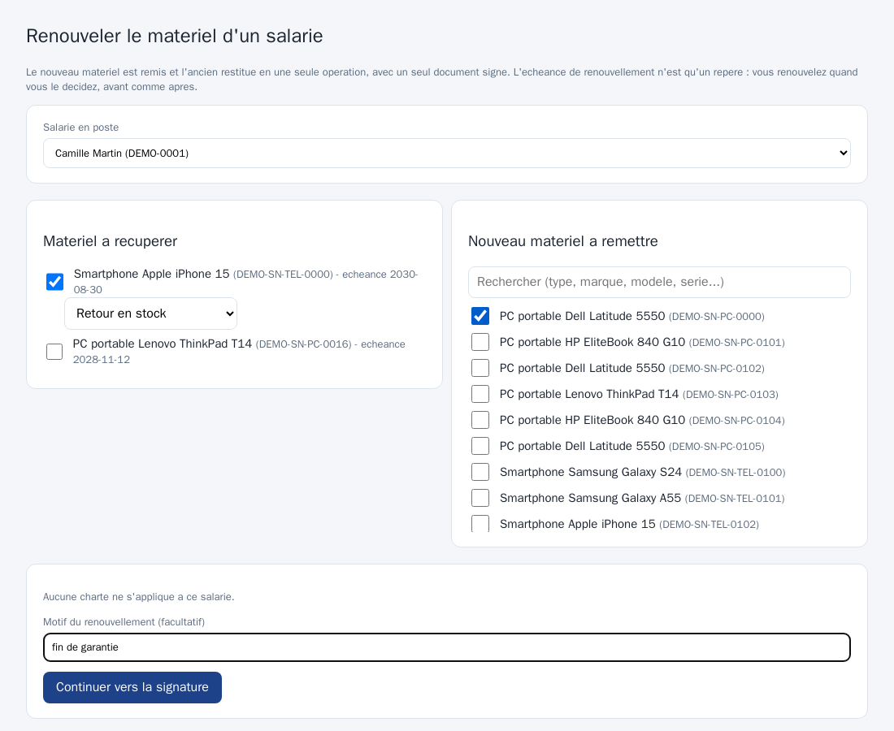
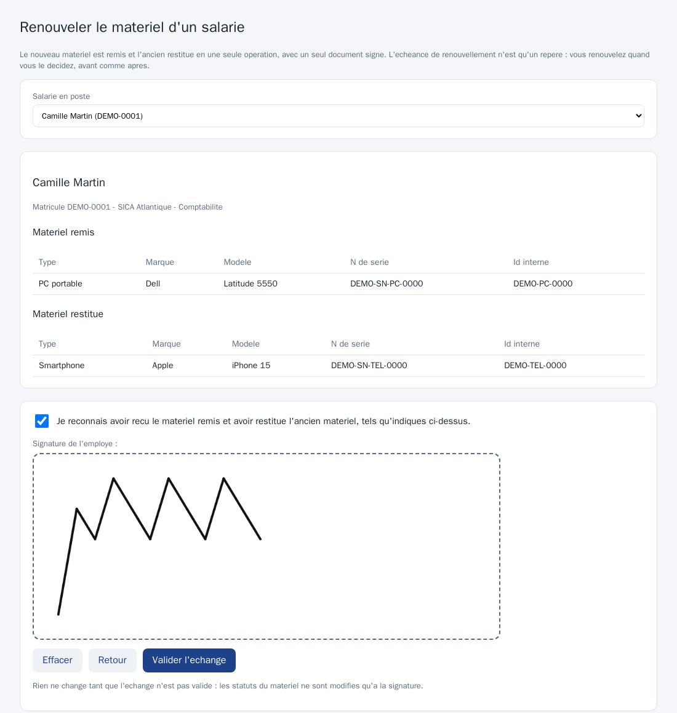
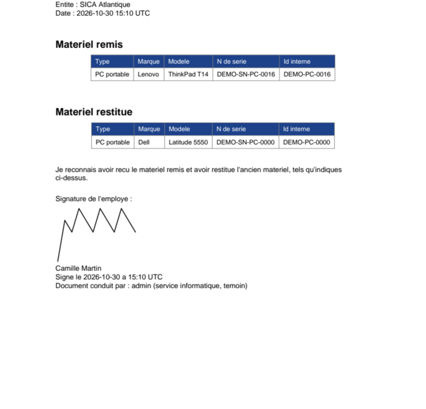
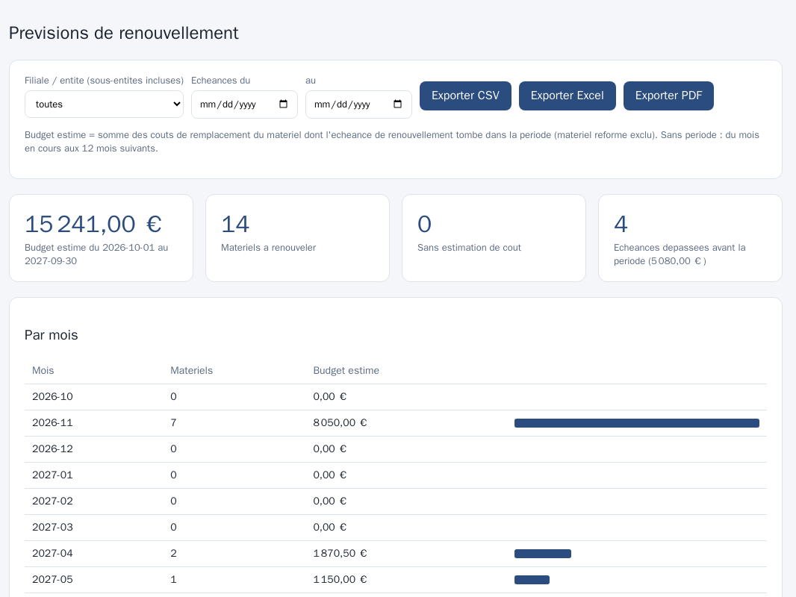
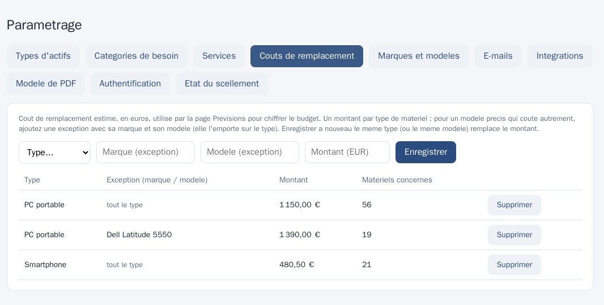
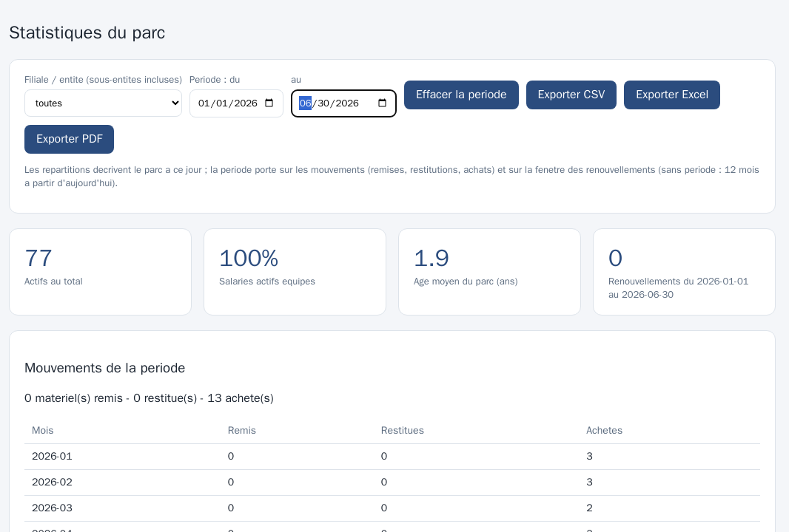
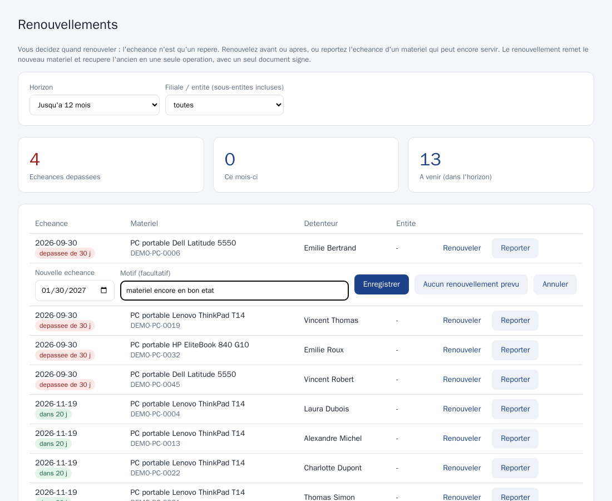
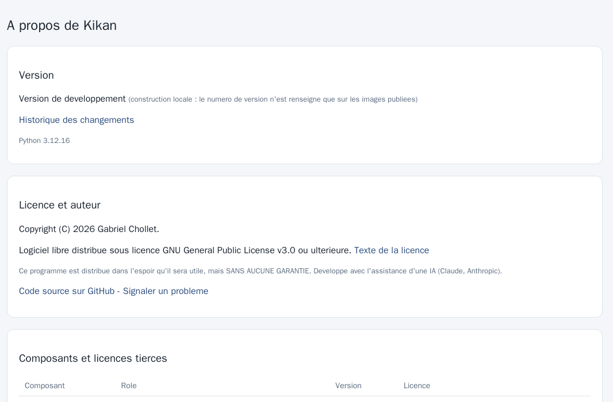
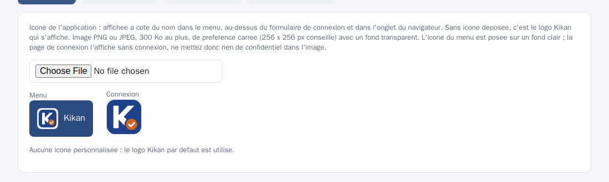
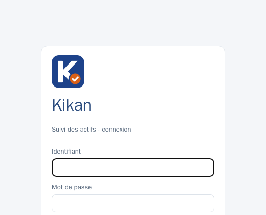

# Guide d'utilisation

Ce guide explique Kikan **par tâche et par rôle**. Il suppose que Kikan est installé (voir le [guide d'installation](INSTALLATION.md)).
Les captures viennent du **jeu de données de démonstration** (personnes et matériel fictifs).

## 1. À quoi sert Kikan

Kikan garde la trace de **qui détient quel matériel** (ordinateurs portables, smartphones) et **quels accès** il a, de l'arrivée au départ,
avec une **preuve** : chaque remise et chaque restitution est signée à l'écran par le salarié, puis le PDF est **scellé** (signature électronique de l'organisation).
Le tout est tracé dans un journal d'audit, pour la démarche ISO 27001.

Principe à retenir : **ce qui a une histoire ne se supprime pas** ; on le désactive, on le passe en « sorti » ou en « réformé ». La suppression définitive des salariés
partis se fait par une **purge RGPD** encadrée (voir la section 7).

## 2. Les trois rôles

| Rôle | Pour qui | Ce qu'il peut faire |
|---|---|---|
| **informatique** | l'équipe informatique | tout : matériel, remises, restitutions, signatures, entités, import, paramétrage, comptes, stockage, sauvegarde, RGPD, journal d'audit |
| **rh** | le service RH | entrées et départs des salariés, **souhaits de matériel** à l'entrée (sans la page Besoins), accès applicatifs, décisions de la revue des accès ; lecture du reste |
| **lecture** | contrôle, direction | consulter et exporter, sans rien modifier |

Les comptes **RH** et **lecture** peuvent être **limités à des entités** (par exemple une seule filiale) : ils ne voient alors que les salariés, le matériel et les accès de ces
entités et de leurs sous-entités. Ce qui est hors de leur périmètre n'apparaît tout simplement pas. Les comptes **informatique** voient toujours tout.

## 3. Se connecter

- Saisissez votre **identifiant** et votre **mot de passe** (12 caractères minimum). Si votre organisation utilise **Microsoft 365**, un bouton de connexion dédié apparaît.
- **Mot de passe oublié ?** (si le lien est proposé) : saisissez votre identifiant ; un lien valable 30 minutes, à usage unique, est envoyé à l'adresse e-mail de votre compte.
  Sinon, demandez à l'informatique de réinitialiser votre mot de passe (page *Comptes*).
- **Changer son mot de passe** : menu **Mon compte**. Vos autres sessions ouvertes sont alors fermées.
- La durée d'une session est réglable (4 heures par défaut) ; passé ce délai, il suffit de se reconnecter. Après 5 échecs de connexion, elle est suspendue 15 minutes.

## 4. Se repérer

Le menu de gauche liste les pages selon votre rôle. Le **tableau de bord** résume la situation :

- les **tuiles** : nombre de salariés, de matériels, de matériels affectés et en stock, **besoins à traiter**, **anomalies d'accès** (en rouge s'il y en a) ; chaque tuile mène à la page concernée ;
- la liste des **départs à suivre** (salariés partis ou en cours de départ) ;
- pour l'informatique, une **alerte** si la dernière sauvegarde est ancienne ou a échoué.

## 5. Le quotidien

### 5.1 Un salarié arrive (RH)

Page **Utilisateurs**, formulaire **Ajouter (formulaire d'entrée)** :

1. Renseignez le matricule, le nom, le prénom, l'e-mail, la **filiale / entité**, le service, la date d'arrivée. Le statut est « actif » ou « prévu » (arrivée à venir).
2. Cochez dans **Matériel souhaité** ce dont le salarié a besoin (par exemple « PC portable avec pavé numérique », « Smartphone Apple »). Vous exprimez un **souhait**, pas un choix de matériel :
   l'informatique retiendra le modèle exact selon le stock. Quand une catégorie propose des **gammes**, un menu apparaît une fois la case cochée : choisissez-en une (**Standard** ou **Haut de gamme**
   pour un PC portable ; **Normal**, **Pro** ou **XL** pour un smartphone Apple) ou laissez « non précisée ». Cela crée automatiquement les **besoins** que l'informatique verra dans sa file de préparation.
   Les catégories et leurs gammes sont gérées par l'informatique (Paramétrage).

   
3. **Ajouter**. **Modifier** corrige la fiche. Les RH n'ont pas de page Besoins : une erreur dans un souhait se signale à l'informatique, qui la corrige.

L'**acronyme** à trois lettres (proposé à partir du prénom et du nom, modifiable) sert à nommer les PDF du salarié.

### 5.2 Suivre les besoins de matériel (informatique)

Page **Besoins** (informatique ; lecture seule pour le rôle lecture ; **pas d'accès pour les RH**) : un besoin passe par **demande**, **en préparation**, **satisfait** (ou **annulé**). La **gamme** souhaitée figure sous le matériel.

- Les besoins viennent des **souhaits** exprimés par les RH à l'entrée d'un salarié ; l'informatique peut aussi en déclarer, modifier (catégorie, gamme, quantité) ou annuler.
- L'**informatique** le prend en charge (« en préparation ») puis le **solde en faisant la remise** : à la création d'une remise, les besoins ouverts du salarié sont proposés d'office et se
  solderont avec elle (section 5.4).
- Des **rappels par e-mail** préviennent des besoins non traités avant une arrivée.

### 5.3 Ajouter du matériel (informatique)

Page **Matériel** (ou **Importer un fichier** en haut à droite pour reprendre un parc existant).

- Les champs **Type**, **Marque** et **Modèle** proposent des suggestions pendant la saisie (insensibles à la casse et aux accents) ; une valeur nouvelle est acceptée.
- Un matériel porte un **identifiant interne**, un **numéro de série**, des dates (achat, fin de garantie, **échéance de renouvellement**), un statut et une entité.
- Les statuts **affecté** et **rendu** viennent des remises et restitutions : on ne les saisit pas. Un matériel qui a déjà été remis ne se supprime pas ; on le passe en **réformé**.

### 5.4 Remettre du matériel (informatique)

Page **Remises**, carte **Nouvelle remise** :

1. Choisissez le **salarié**. Ses **besoins ouverts** apparaissent et sont proposés d'office.
2. Choisissez la **charte jointe** : « Automatique » applique la charte de son entité (ou de l'entité parente, ou la charte globale).
3. Cochez le **matériel en stock** à remettre, puis **Créer l'affectation**.
4. Dans la liste des **affectations**, une remise « non signée » attend la signature : bouton **Signer**.

**La signature** se fait avec le salarié, de préférence sur une **tablette** :

1. L'écran rappelle le salarié (nom repris de sa fiche, **non modifiable**), le matériel remis et la charte.
2. Le salarié coche **« Je reconnais avoir reçu le matériel ci-dessus »**, **signe dans le cadre** (le bouton *Effacer* recommence), puis **Valider et signer**.
3. Kikan produit le **PDF**, y insère la signature, la date et l'heure, le salarié et le compte qui conduit la remise, puis le **scelle**. Une remise ne se signe **qu'une seule fois**.
4. Le bouton **PDF scellé** de la liste affiche ou télécharge le document.

Le nom du fichier suit toujours le même modèle, sans hasard : **`AAAA_MM_JJ_NOM_PRENOM_ACR_NNN.pdf`** (date de signature, nom, prénom, acronyme, compteur propre au salarié), rangé dans le dossier de l'année.

### 5.5 Un salarié part (RH ou informatique)

Page **Sorties** :

1. **Déclarer un départ** : choisissez le salarié et la **date de sortie** (RH ou informatique). Le salarié passe « en départ » ; des **rappels** préviennent avant la date, puis si du matériel n'est pas revenu.
2. À la restitution, **Restituer et signer** (RH ou informatique) ouvre l'écran de signature : le salarié reconnaît avoir **restitué** le matériel listé. Un PDF scellé de **restitution** est produit.
3. Le matériel repasse « rendu » et le salarié passe **« sorti »**. Il n'est pas supprimé : il sera purgé plus tard (section 7).

Tant que du matériel n'est pas revenu, le salarié reste affiché dans **Départs en cours - matériel à récupérer** et les rappels continuent.

### 5.6 Accès aux applications (RH et informatique)

Page **Accès applicatifs** : le **catalogue des applications** (informatique) et, par salarié, les **accès accordés** avec une précision (profil, droits). Les applications peuvent être
propres à une entité. Une application sans accès peut être supprimée ; sinon on la **désactive**. Un accès qui est retiré passe à « non » (l'historique est conservé).

### 5.7 Renouveler le matériel d'un salarié en poste (informatique)

L'informatique décide du renouvellement, **avant ou après l'échéance** : la date de renouvellement n'est qu'un repère (pages Renouvellements, section 6.4, et Prévisions ; rappels). Pour renouveler, un seul geste remet le nouveau
matériel **et** récupère l'ancien, avec **un seul document signé**.

1. Lancez l'opération depuis la page **Renouvellements** (bouton **Renouveler**), la page **Matériel** (bouton **Renouveler** sur un matériel affecté : le salarié est reconnu automatiquement) ou **Utilisateurs** (bouton **Renouveler** d'un salarié en poste).
2. À gauche, **cochez le matériel à récupérer** et choisissez son **devenir** : *Rendu* (à traiter ensuite), *Retour en stock* ou *À réformer*. À droite, **cochez le nouveau matériel** en stock (recherche par type, marque, modèle ou série).
3. Au besoin : soldez les **besoins ouverts** du salarié, **joignez la charte** (case décochée par défaut : le salarié l'a déjà signée à son arrivée) et indiquez un **motif** (facultatif).

   
4. **Continuer vers la signature** : l'écran récapitule le matériel remis et le matériel restitué. Le salarié coche la déclaration et **signe sur la tablette**, puis **Valider l'échange**.

   
5. Rien ne change tant que l'échange n'est pas validé. À la validation, le nouveau matériel passe **affecté**, l'ancien prend le devenir choisi, et Kikan produit le **PDF scellé** (un seul numéro de document).

   

Le renouvellement peut être **partiel** : le salarié garde ce que vous ne cochez pas (son smartphone, par exemple), et seule l'affectation entièrement rendue est clôturée. Dans la liste des remises, l'échange apparaît avec le
badge **échange** et la liste du matériel restitué ; le bouton **PDF scellé** ouvre l'accusé d'échange. Réservé à un salarié **en poste** (statut actif).

## 6. Contrôler et rendre compte

| Page | Pour quoi faire |
|---|---|
| **Rapports** | la photo des **détentions à l'instant T** (qui détient quoi), filtrable par entité et service, exportable en **CSV, Excel ou PDF** |
| **Statistiques** | répartition du parc par entité, service, modèle ; **renouvellements à venir** ; filtres par **entité** et par **période** (mouvements remis, restitués, achetés) ; export **CSV, Excel et PDF** (section 6.3) |
| **Renouvellements** (informatique) | matériel **à renouveler** (échéance dépassée ou proche) avec son détenteur ; boutons **Renouveler** et **Reporter** (section 6.4) |
| **Prévisions** | **échéances de renouvellement** et **budget estimé** par mois, année, type et entité, sur la période de votre choix (12 mois par défaut) ; export **CSV, Excel et PDF** (section 6.2) |
| **Revue des accès** | anomalies d'accès, rapport « qui a accès à quoi » et **campagnes de revue** (section 6.1) |
| **À propos** (lien en bas du menu, tous les comptes) | version de Kikan et date de publication, licence, auteur, composants et licences tierces |
| **Journal d'audit** (informatique) | qui a fait quoi et quand : connexions, écritures, refus. Jamais de mot de passe ni de contenu personnel inutile |

### 6.1 Revue des droits d'accès

Exigence de revue périodique de l'ISO 27001 (A.5.18). Voir le détail dans [REVUE-ACCES.md](REVUE-ACCES.md).

1. **Anomalies** : accès actifs d'un salarié **sorti**, dont la date de sortie est **dépassée**, ou vers une application **désactivée**. À corriger sans attendre une campagne.
2. **Lancer une revue** (informatique) : titre, date limite, entités et applications. Une ligne est créée pour chaque accès actif.
3. **Décider** (RH dans leur périmètre, informatique) : cochez des lignes, puis **Maintenir** ou **À retirer** (commentaire facultatif).

   

4. **Clôturer** (informatique) une fois tout décidé : les accès « à retirer » passent à « non » dans Kikan, un **rapport PDF scellé** est enregistré, et les retraits deviennent des tâches.
5. **Retraits à confirmer** : Kikan est un registre ; une fois le droit retiré dans l'application concernée, l'informatique le confirme.

### 6.2 Prévisions de renouvellement et budget

La page **Prévisions** répond à « combien faudra-t-il prévoir, et quand ? ».

1. **Choisir** l'entité (ses sous-entités sont comprises) et la période des échéances. Sans choix : du mois en cours aux 12 mois suivants.
2. **Lire** le budget estimé, le nombre de matériels à renouveler, puis le détail par **mois**, **année**, **type** et **entité**.
3. **Exporter** en CSV, Excel (les montants restent des nombres, additionnables) ou PDF.

Le budget est la somme des **coûts de remplacement** des matériels dont l'échéance de renouvellement tombe dans la période (matériel réformé exclu). Ces coûts
sont saisis par l'informatique dans **Paramétrage, Coûts de remplacement** : un montant par type, et si besoin une exception pour un modèle précis (marque et modèle).
Un matériel **sans coût** n'est pas dans le total : la page indique combien ils sont, pour que le budget ne paraisse pas plus bas qu'il ne l'est. Les **échéances déjà
dépassées** avant la période (matériel non renouvelé) sont signalées à part. Aucune donnée de salarié n'apparaît dans cette page.

### 6.3 Statistiques : filtrer et exporter

Sur la page **Statistiques**, choisissez une **entité** (ses sous-entités sont comprises) et, si vous le souhaitez, une **période**. Les répartitions (modèles, entités, services,
âge moyen) décrivent toujours le parc **à ce jour** ; la période sert aux **mouvements** (matériels remis, restitués et achetés, mois par mois) et à la fenêtre des
renouvellements. Les boutons **Exporter CSV, Excel ou PDF** reprennent ce qui est affiché. Un compte limité à certaines entités ne voit et n'exporte que son périmètre.

### 6.4 Renouvellements (informatique)

La page **Renouvellements** liste le matériel **en stock ou affecté** dont l'échéance de renouvellement est **dépassée** ou proche, avec son **détenteur** : un tableau de bord de décision pour l'informatique, qui est **seule à décider** du renouvellement. Choisissez un **horizon**
(échéances dépassées seulement, 1, 3, 6 ou 12 mois) et, si besoin, une entité. La tuile **« Échéances de renouvellement dépassées »** du tableau de bord y mène.

- **Renouveler** (matériel détenu) ouvre l'échange (section 5.7) : le nouveau matériel est remis et l'ancien récupéré en une seule opération, avec un seul document signé.
- **Reporter** : l'échéance n'est qu'un repère. Vous pouvez la **repousser** (le matériel peut encore servir) ou l'**avancer**, avec une nouvelle date (aujourd'hui ou plus tard) et, si vous le souhaitez, un **motif**. *Aucun renouvellement prévu* supprime l'échéance.
  Le dernier report et son motif restent affichés sous l'échéance ; le journal d'audit ne garde que les dates.
- Un matériel **rendu ou réformé** n'apparaît plus : il n'est plus à renouveler, et il sort aussi des prévisions et des rappels.

### 6.5 À propos

Le lien **À propos**, en bas du menu, donne la **version** de Kikan et sa date de publication (avec un lien vers les notes de la version), la **licence** (GPL v3), l'auteur, le lien
du code source et du signalement d'un problème, ainsi que les **composants** utilisés avec leur version et leur licence. Une installation construite en local indique « version de
développement » : le numéro n'est renseigné que sur les images publiées. Utile pour un signalement ou avant une mise à jour.

## 7. Administration (informatique)

| Page | Pour quoi faire |
|---|---|
| **Entités** | le groupe et ses filiales (parent, activation). Une entité utilisée se désactive, elle ne se supprime pas |
| **Chartes** | déposer la charte (Word, PDF ou Markdown), globale ou par entité. Une nouvelle version **archive** l'ancienne ; les documents déjà signés ne changent pas |
| **Import** | reprise de l'existant par **CSV ou Excel**, dans l'ordre : entités, applications, salariés, matériel, affectations, accès. Toujours **simulation d'abord**, puis import réel « tout ou rien ». Un import réalisé peut être **annulé** tant que rien de ce qu'il a créé n'est utilisé |
| **Paramétrage** | types et services, catégories de besoin et **gammes proposées aux RH**, **coûts de remplacement** (budget des prévisions), **apparence** (icône de l'application), fusion des marques et modèles, **modèle de PDF** (logo, mentions), **E-mails** (SMTP, rappels, rapport mensuel), **intégrations** (jetons d'API, GLPI), connexion Microsoft 365 |
| **Comptes** | créer des comptes nominatifs, choisir le rôle et le **périmètre** (RH, lecture), réinitialiser un mot de passe, désactiver |
| **Stockage** | où sont rangés les PDF scellés ; test de connexion ; copie vers un nouveau moteur |
| **Sauvegarde** | état de la dernière sauvegarde chiffrée ; l'alerte du tableau de bord |
| **RGPD** | durée de conservation des salariés sortis et **purge** (section 7.1) |

### 7.1 Purge RGPD

Les salariés sortis sont conservés pendant une durée **réglable** (12 mois par défaut) après leur sortie. La page **RGPD** :

1. **Prévisualiser** la liste des salariés dont la durée est atteinte, puis **Purger** (action volontaire de l'informatique, jamais automatique).
2. Leurs données disparaissent de Kikan. Leurs **PDF scellés** vont dans le dossier **`A_PURGER`** du partage, puis sont **supprimés définitivement** après un **délai de grace** réglable (30 jours par défaut) ; d'ici là,
   « Remettre à l'origine » les récupère en cas d'erreur.
3. **SharePoint et DocuWare** : Kikan **ne supprime rien** ; il liste les documents à faire supprimer par l'équipe de la GED, qui confirme ensuite.
4. Un **rappel par e-mail** prévient si la purge n'a pas été faite à l'échéance.

Le détail (traçabilité, sauvegardes, limites) est dans [RGPD.md](RGPD.md).

### 7.2 E-mails

Dans **Paramétrage, E-mails** : serveur SMTP, expéditeur, adresse de liste, **rappels** (renouvellements, départs, matériel non restitué, besoins, purge, revue des accès) et **rapport mensuel**.
Chaque personne ne reçoit que ce qui concerne son périmètre.

### 7.3 Personnaliser l'icône de l'application

**Paramétrage, onglet Apparence** (informatique) : choisissez une image **PNG ou JPEG** (300 Ko au plus, de préférence carrée, 256 x 256 px conseillé, fond transparent). Kikan la vérifie et la
réencode, puis l'affiche **à côté du nom dans le menu** (sur une pastille claire), **au-dessus de la connexion** et comme **icône de l'onglet** du navigateur. Les deux aperçus montrent le rendu
avant de quitter la page. **Supprimer l'icône** revient au **logo Kikan** par défaut (le carré bleu au K blanc et à la pastille orange). Le nom « Kikan » ne change pas.

L'icône de la page de connexion est lisible **sans être connecté** : n'y mettez rien de confidentiel.

## 8. Je veux...

| Je veux... | Où | Qui |
|---|---|---|
| enregistrer l'arrivée d'un salarié | Utilisateurs, formulaire d'entrée | RH |
| signaler qu'il lui faut un PC ou un téléphone | cases « Matériel souhaité » et gamme, au formulaire d'entrée | RH |
| remettre un PC et le faire signer | Remises, puis Signer | informatique |
| renouveler le matériel d'un salarié (remettre du neuf, récupérer l'ancien) | Matériel ou Utilisateurs, bouton Renouveler | informatique |
| retrouver le PDF d'une remise | Remises, bouton « PDF scellé » | informatique, RH, lecture |
| déclarer un départ | Sorties, Déclarer un départ | RH, informatique |
| récupérer le matériel d'un partant | Sorties, Restituer et signer | RH, informatique |
| savoir qui détient quoi aujourd'hui | Rapports | tous |
| connaître les matériels à renouveler | Statistiques, Prévisions ou rappels e-mail | informatique |
| chiffrer le budget de renouvellement | Prévisions (coûts à renseigner dans Paramétrage, Coûts de remplacement) | tous (coûts : informatique) |
| donner ou retirer un accès applicatif | Accès applicatifs | RH, informatique |
| repérer les accès à retirer | Revue des accès, onglet Anomalies | tous |
| reprendre mon parc existant | Import (simulation puis import réel) | informatique |
| corriger un import raté | Import, « Annuler cet import » | informatique |
| créer le compte d'une nouvelle personne | Comptes | informatique |
| limiter un compte à une filiale | Comptes, périmètre | informatique |
| changer mon mot de passe | Mon compte | tous |
| supprimer les données d'un ancien salarié | RGPD, Prévisualiser puis Purger | informatique |
| vérifier que la sauvegarde tourne | tableau de bord ou page Sauvegarde | informatique |
| comprendre une action passée | Journal d'audit | informatique |

## 9. Bon à savoir

- **On ne modifie pas une preuve** : un PDF scellé ne se change pas. Pour corriger une erreur de saisie, on corrige la fiche ; pour un PDF erroné, on refait l'opération de façon traçable.
- **Les refus sont expliqués** : « utilisé par 3 salariés... » indique précisément ce qui empêche une suppression.
- **Les listes sont souples** : une valeur nouvelle (type, marque, service) saisie ou importée s'ajoute sans bloquer.
- **Rien n'est supprimé en silence** : l'archivage, la désactivation et la purge laissent une trace dans le journal d'audit.
- **Besoin d'aide ?** Contactez l'informatique ; pour un problème technique, voir le [dépannage](INSTALLATION.md#11-dépannage).
