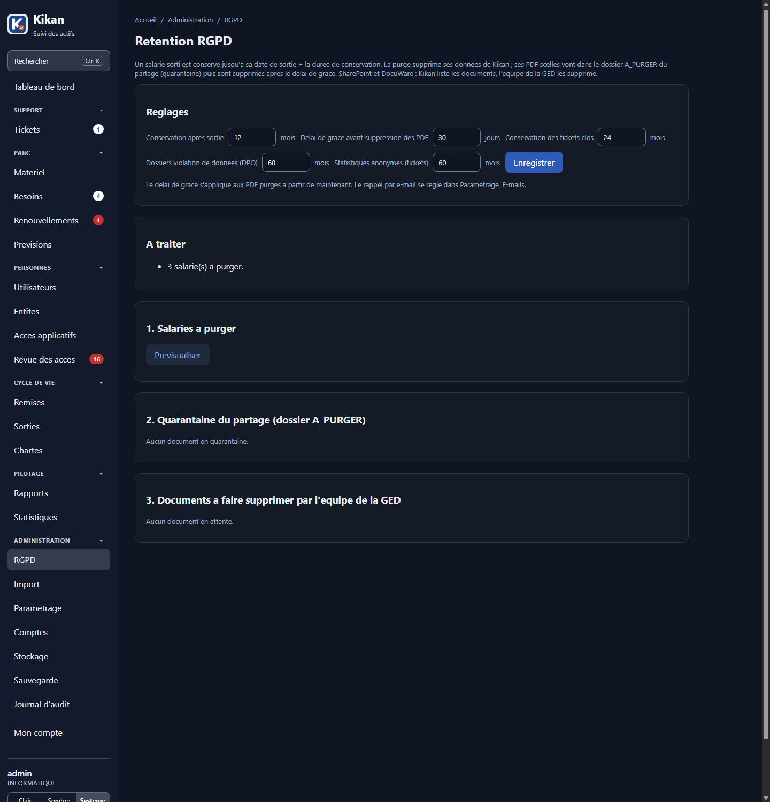

# Purge RGPD

Kikan conserve les données d'un salarié sorti pendant une durée **réglable**, puis les purge. La purge est lancée par un **bouton réservé à
l'informatique** (page *RGPD*), jamais automatiquement ; un **rappel par e-mail** prévient si elle n'est pas faite à l'échéance.

## Réglages (page RGPD)

*Capture réalisée avec des données de démonstration.*

| Réglage | Par défaut | Plage | Rôle |
|---|---|---|---|
| Conservation après sortie | 12 mois | 0 à 240 mois | un salarié sorti est purgeable à partir de *date de sortie + cette durée* |
| Délai de grâce | 30 jours | 0 à 365 jours | temps pendant lequel un PDF ou une pièce jointe rangé en quarantaine reste avant suppression définitive |
| Conservation des tickets clos | 24 mois | 0 à 120 mois | un ticket fermé ou annulé est anonymisable à partir de *date de fermeture + cette durée* |
| Conservation des violations de données | 60 mois | 12 à 120 mois | durée propre aux dossiers d'incident avec violation potentielle (art. 33.5, à valider avec le DPO) |
| Conservation des statistiques de tickets | 60 mois | 12 à 120 mois | suppression définitive des tickets anonymisés (ne peut pas être inférieure à la conservation des tickets clos) |

Rien n'est codé en dur : ces cinq valeurs se modifient à tout moment, et chaque changement est journalisé. Le délai de grâce s'applique aux
documents purgés **à partir de la modification**. Le rappel par e-mail se règle dans *Paramétrage, E-mails* (actif par défaut, relance toutes les
semaines).

## Déroulement

1. **Prévisualiser** : la liste des salariés dont la conservation est échue. Seuls ceux de la liste affichée sont purgés.
2. **Purger** : les données du salarié (fiche, remises, signatures, besoins, liens vers les systèmes externes comme GLPI) sont supprimées de Kikan, de façon irréversible. Les liens du matériel sont conservés : le matériel n'est pas une donnée personnelle. Les PDF scellés
   sont suivis dans la même transaction : il n'y a jamais de PDF oublié sans trace.
3. **Partage SMB, WebDAV ou volume local** : chaque PDF est copié dans le dossier `A_PURGER/` du même moteur, relu et comparé par empreinte
   SHA-256, puis l'original est supprimé. Si le partage est indisponible, le rangement est **réessayé** (bouton *Réessayer le rangement*).
4. **Suppression définitive** : une fois le délai de grace écoulé, le bouton *Supprimer définitivement les documents échus* efface les PDF.
   Pendant le délai, *Remettre à l'origine* replace un PDF à son emplacement (erreur de date de sortie, par exemple).
5. **SharePoint et DocuWare** : Kikan **ne supprime rien** dans ces GED. Il liste les documents (moteur, référence, échéance) ; l'équipe de la GED
   les supprime, puis l'informatique clique sur *La GED a supprimé ces documents*. *Copier la liste* facilite l'envoi à l'équipe de la GED.

## Rappels par e-mail

Aux destinataires informatique, un message regroupe (nombres seulement, aucun nom) :

- les salariés à purger ;
- les documents en quarantaine dont le délai de grace est écoulé ;
- les documents à faire supprimer par l'équipe de la GED (échéance dépassée) ;
- les documents qui n'ont pas pu être rangés en quarantaine.

## Traçabilité

Le journal d'audit enregistre la purge (nombre de salariés et de documents), chaque déplacement ou suppression, la confirmation de la GED et les
changements de réglage, **sans nom ni matricule**. Pour chaque PDF supprimé, il garde son **empreinte SHA-256** : on peut prouver qu'un document a
existé sans conserver de donnée personnelle.

Le journal ne conserve pas non plus ce qu'une personne a tapé en se connectant avec un compte inconnu (parfois l'adresse d'un tiers ou un mot
de passe saisi dans le mauvais champ) : il garde `inconnu:` suivi d'une empreinte non réversible, qui permet de reconnaître des tentatives
répétées sans donnée personnelle. La purge d'un salarié supprime aussi sa ligne de correspondance avec un système externe (GLPI par exemple).
Les entrées de journal enregistrées avant cette protection ne sont pas réécrites.

## Registre des traitements

Un **modèle de registre des activités de traitement** (article 30 du RGPD), prérempli avec ce que fait Kikan (finalités, données, destinataires, durées, mesures de sécurité), est fourni dans [modeles/registre-traitements-rgpd.md](modeles/registre-traitements-rgpd.md). À compléter par votre organisation et à faire valider par son DPO.

## Limites à connaître

- **Les sauvegardes** (30 jours, puis une par mois pendant un an) contiennent encore les données purgées jusqu'à leur expiration. À mentionner dans
  le registre des traitements. Après une restauration, relancer la purge.
- Pendant le délai de grace, le nom du fichier en quarantaine contient encore le nom du salarié (il est identique à celui d'origine).
- Les chartes d'usage et les autres documents de l'organisation ne sont pas concernés.

## Tickets et pièces jointes (v0.9)

Les tickets, leurs pièces jointes et leurs statistiques anonymes sont intégrés à la page *RGPD* en trois étapes manuelles réservées au rôle `informatique` :

1. **Purge d'un salarié sorti (`POST /rgpd/purge`)** : avant de supprimer la fiche du salarié, Kikan supprime son compte portail `demandeur` et anonymise tous ses tickets (ouverts ou clos).
2. **Purge des tickets clos (`POST /rgpd/purge-tickets`)** : anonymise les tickets fermés ou annulés dont la durée *Conservation des tickets clos* (24 mois par défaut) est échue, et efface au passage les champs textuels (`cause_racine`, `actions_correctives`) et dates exactes des dossiers de violation de données dont la durée dédiée (60 mois par défaut) est échue.
   - **Effet de l'anonymisation** : suppression des commentaires et des liens externes (`external_links`), mise en quarantaine (`A_PURGER/`) des pièces jointes (soumises au même délai de grâce avant suppression définitive ; contrairement aux PDF scellés, une pièce jointe en quarantaine ne peut pas être restaurée, refus `409`), effacement des textes libres (`titre`, `description`), coupure des liens nominatifs et matériel (`user_id`, comptes, `asset_id`, `assignment_id`), remplacement de la référence par `ANON-<id>` et arrondi des dates au premier du mois. Les métriques anonymes précalculées (`mtta_sec`, `mttr_sec`, nature, criticité, compteurs sécurité) sont conservées.
   - **Exception violation de données (art. 33.5)** : sur un dossier sans violation potentielle, `cause_racine` et `actions_correctives` sont effacés dès l'anonymisation ; sur un incident avec violation potentielle, ils sont conservés jusqu'à l'échéance de *Conservation des violations de données* (60 mois par défaut).
3. **Purge des statistiques de tickets (`POST /rgpd/purge-stats-tickets`)** : supprime définitivement les lignes de tickets anonymisées (et leur dossier sécurité) une fois échue la *Conservation des statistiques de tickets* (60 mois par défaut, prolongée jusqu'à l'échéance violation le cas échéant).

Chaque opération est tracée dans le journal d'audit (`rgpd_purge`, `rgpd_purge_tickets`, `rgpd_purge_violations`, `rgpd_purge_stats_tickets`) par compteurs uniquement, sans donnée personnelle. En complément des rappels RGPD hebdomadaires, tout incident avec violation potentielle sans notification DPO déclenche un rappel automatique toutes les 12 h pour le suivi du délai de 72 h (article 33).

## Tests

`tests/purge_check.py` (réglages, quarantaine, suppression, restauration, GED, rappels), `tests/tickets_check.py` (anonymisation, purge tickets clos, violations et statistiques), `tests/attachments_check.py` (quarantaine et suppression des pièces jointes) et `tests/verrous_check.py` (double clic) ; voir
[SECURITY.md](../SECURITY.md).
