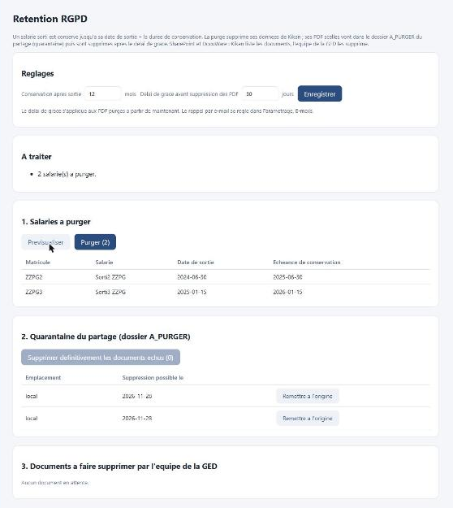

# Purge RGPD

Kikan conserve les données d'un salarié sorti pendant une durée **réglable**, puis les purge. La purge est lancée par un **bouton réservé à
l'informatique** (page *RGPD*), jamais automatiquement ; un **rappel par e-mail** prévient si elle n'est pas faite à l'échéance.

## Réglages (page RGPD)

*Capture réalisée avec des données de démonstration.*

| Réglage | Par défaut | Rôle |
|---|---|---|
| Conservation après sortie | 12 mois | un salarié sorti est purgeable à partir de *date de sortie + cette durée* (0 à 240 mois) |
| Délai de grace | 30 jours | temps pendant lequel un PDF rangé en quarantaine reste récupérable (0 à 365 jours) |

Rien n'est codé en dur : ces deux valeurs se modifient à tout moment, et chaque changement est journalisé. Le délai de grace s'applique aux
PDF purgés **à partir de la modification**. Le rappel par e-mail se règle dans *Paramétrage, E-mails* (actif par défaut, relance toutes les
semaines).

## Déroulement

1. **Prévisualiser** : la liste des salariés dont la conservation est échue. Seuls ceux de la liste affichée sont purgés.
2. **Purger** : les données du salarié (fiche, remises, signatures, besoins) sont supprimées de Kikan, de façon irréversible. Les PDF scellés
   sont suivis dans la même transaction : il n'y a jamais de PDF oublié sans trace.
3. **Partage SMB, WebDAV ou volume local** : chaque PDF est copié dans le dossier `A_PURGER/` du même moteur, relu et comparé par empreinte
   SHA-256, puis l'original est supprimé. Si le partage est indisponible, le rangement est **réessayé** (bouton *Réessayer le rangement*).
4. **Suppression définitive** : une fois le délai de grace écoulé, le bouton *Supprimer définitivement les documents échus* efface les PDF.
   Pendant le délai, *Remettre à l'origine* replace un PDF à son emplacement (erreur de date de sortie, par exemple).
5. **SharePoint et DocuWare** : Kikan **ne supprime rien** dans ces GED. Il liste les documents (moteur, référence, échéance) ; l'équipe de la GED
   les supprime, puis l'informatique clique sur *La GED a supprimé ces documents*. *Copier la liste* facilite l'envoi à l'équipe de la GED.

## Rappels par e-mail

Aux destinataires informatique, un message regroupe (nombres seulement, aucun nom) :

- les salariés à purger ;
- les documents en quarantaine dont le délai de grace est écoulé ;
- les documents à faire supprimer par l'équipe de la GED (échéance dépassée) ;
- les documents qui n'ont pas pu être rangés en quarantaine.

## Traçabilité

Le journal d'audit enregistre la purge (nombre de salariés et de documents), chaque déplacement ou suppression, la confirmation de la GED et les
changements de réglage, **sans nom ni matricule**. Pour chaque PDF supprimé, il garde son **empreinte SHA-256** : on peut prouver qu'un document a
existé sans conserver de donnée personnelle.

## Limites à connaître

- **Les sauvegardes** (30 jours, puis une par mois pendant un an) contiennent encore les données purgées jusqu'à leur expiration. À mentionner dans
  le registre des traitements. Après une restauration, relancer la purge.
- Pendant le délai de grace, le nom du fichier en quarantaine contient encore le nom du salarié (il est identique à celui d'origine).
- Les chartes d'usage et les autres documents de l'organisation ne sont pas concernés.

## Tests

`tests/purge_check.py` (réglages, quarantaine, suppression, restauration, GED, rappels) et `tests/verrous_check.py` (double clic) ; voir
[SECURITY.md](../SECURITY.md).
