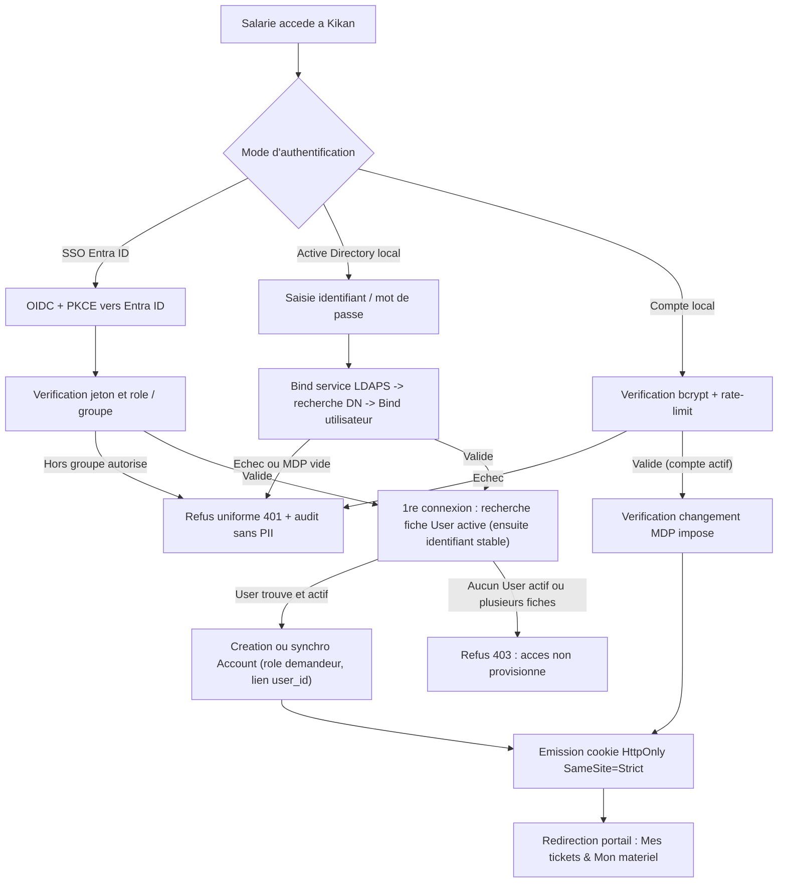
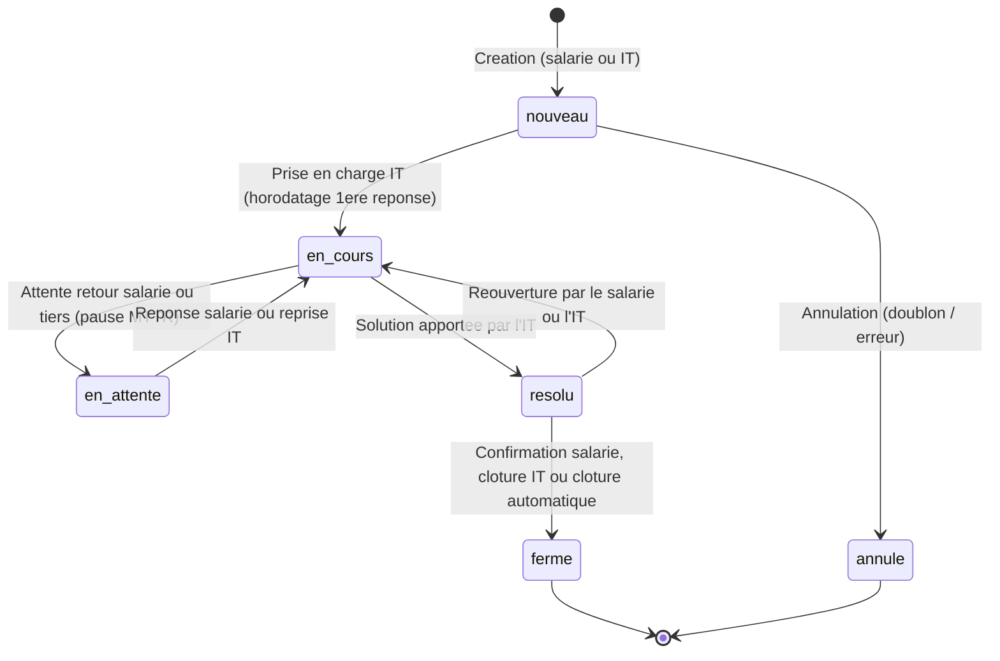
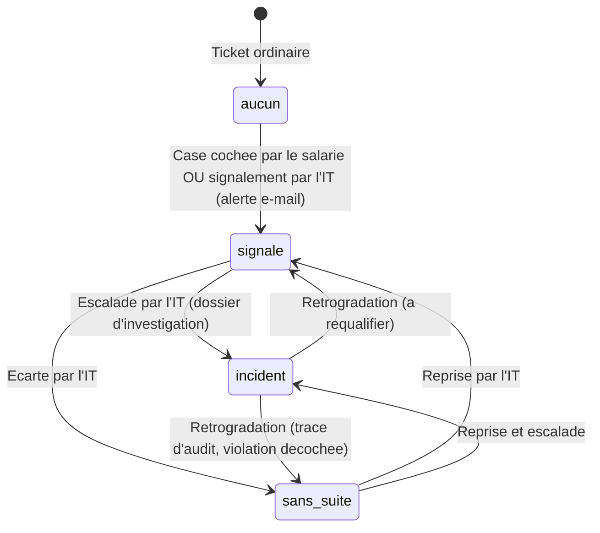
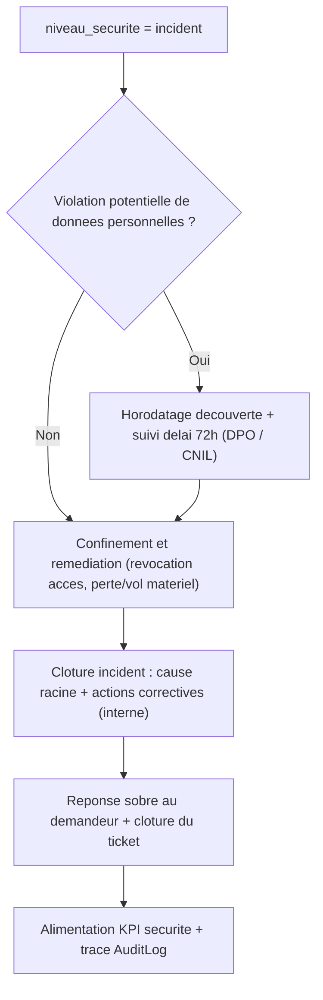
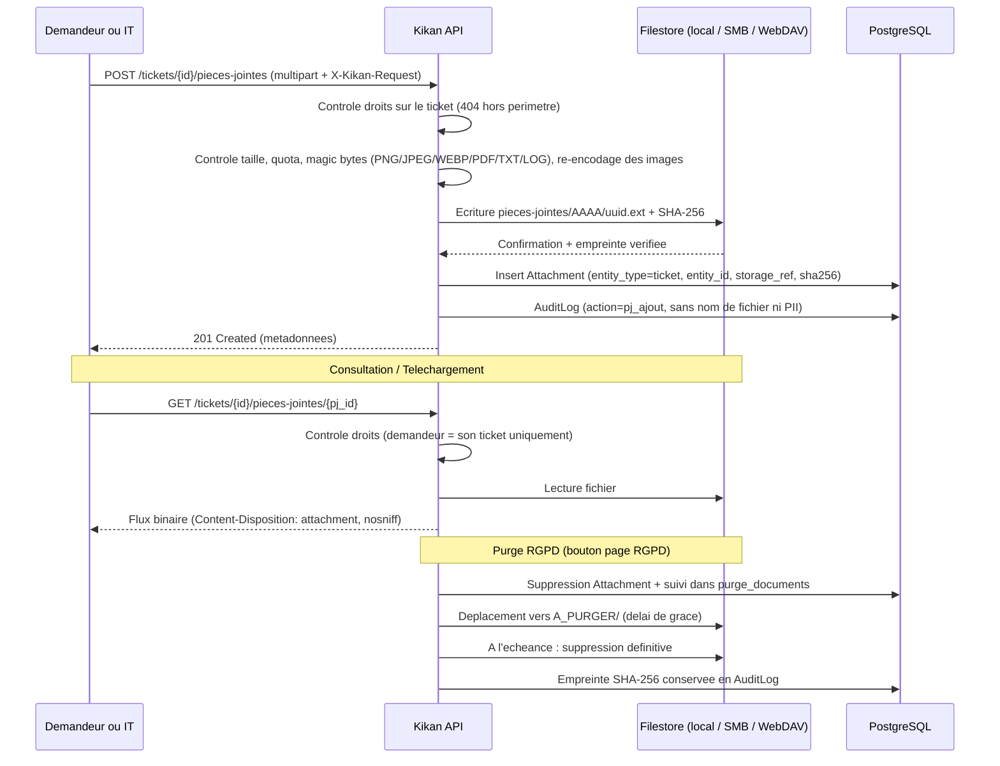

# Spécification fonctionnelle et technique - Gestion de tickets native (v0.9)

> **Statut** : lots `G1`, `G2`, `G3`, `G4a`, `G4b`, `G6` et `G7` livrés et fusionnés sur `main` (migrations `0025` à `0029`, suites automatisées vertes). Seul le lot conditionnel `G5` (`#179`, AD local LDAP/LDAPS) reste à implémenter.
> **Milestone GitHub** : `v0.9 - Tickets` (7/8 issues fermées dans le projet *Kikan - feuille de route*).
> **Date** : 2026-11-24.

---

## 1. Objectif, contexte et alignement ISO 27001

Ajouter à Kikan un module **natif** de gestion de tickets (incidents, demandes de support, événements et incidents de sécurité) accompagné d'un **portail salarié**, afin que les petites et moyennes structures puissent gérer leur parc matériel et leur support informatique dans un seul outil, **sans devoir déployer GLPI** en parallèle.

Le connecteur GLPI existant (`B5`) reste disponible pour les organisations qui disposent déjà de GLPI.

### Alignement ISO/IEC 27001:2022 (Annexe A)
En complément des contrôles déjà soutenus par Kikan (`A.5.9`, `A.5.10`, `A.5.11`, `A.5.18`), ce module soutient :
- **A.6.8** - Signalement des événements de sécurité de l'information (canal dédié accessible aux salariés).
- **A.5.24 à A.5.26** - Planification, évaluation et réponse aux événements et incidents de sécurité de l'information (qualification, escalade, confinement, traçabilité).
- **A.5.27** - Tirer des enseignements des incidents de sécurité (cause racine, actions correctives, KPI sécurité).

> **Important** : Kikan facilite la conformité du SMSI mais n'est pas certifié ISO 27001.

---

## 2. Acteurs, rôles et matrice des droits (RBAC)

Un 4e rôle **`demandeur`** est ajouté aux rôles existants (`informatique`, `rh`, `lecture`). Un compte `demandeur` est obligatoirement rattaché à une fiche salarié active (`accounts.user_id -> users.id`).

| Capacité / Ressource | `demandeur` (salarié) | `informatique` | `rh` | `lecture` |
|---|---|---|---|---|
| Ouvrir un ticket | Oui (pour lui-même ; ses actifs affectés sont pré-proposés) | Oui (pour tout salarié, actif ou ticket interne IT) | Non (les RH continuent d'utiliser `Besoins` à l'arrivée) | Non |
| Consulter la liste et le détail des tickets | **Uniquement ses propres tickets** (règle 1 ci-dessous) | Tous (global) | Aucun accès aux tickets individuels | Aucun accès aux tickets individuels |
| Consulter son matériel affecté | Oui (lecture seule dans *Mon espace*) | Tous (global) | Périmètre d'entité | Périmètre d'entité |
| Commentaires publics | Lecture + ajout sur ses propres tickets (non fermés/annulés) | Lecture + ajout | Non | Non |
| Notes internes IT | **Jamais visibles** (filtrées côté serveur) | Lecture + ajout | Non | Non |
| Pièces jointes | Ajout + téléchargement sur ses propres tickets | Ajout + téléchargement + suppression | Non | Non |
| Signaler un événement de sécurité | Oui (case dédiée à l'ouverture) | Oui (ouverture ou requalification) | Non | Non |
| Qualifier un signalement, escalader en `incident`, rétrograder | Non (ne voit que son ticket public, jamais le dossier d'investigation) | Oui (qualification, escalade, rétrogradation, confinement, clôture) | Non | Non |
| Statistiques et KPI tickets | Non | Oui (global, exports CSV/Excel) | Non en v0.9 | Non en v0.9 |
| Gestion des comptes salariés et AD/LDAP | Non | Oui | Non | Non |
| Reste de Kikan (parc, salariés, recherche `Ctrl+K`, statistiques, paramétrage, chartes, revues) | **Aucun accès** (refus par défaut, voir règle 4) | Inchangé | Inchangé | Inchangé |

### Règles impératives de contrôle d'accès
1. **Isolation stricte du demandeur** : côté API, toute requête sur `/tickets*` ou `/mon-espace/*` émise par un `demandeur` passe par une dépendance unique `demandeur_dep`, qui vérifie **à chaque requête** :
   - que `current_account.user_id` n'est **pas nul** (un compte sans fiche salarié n'a accès à rien : sinon la comparaison de deux valeurs nulles donnerait accès aux tickets internes IT et aux tickets anonymisés) ;
   - que la fiche `User` liée existe et a le statut `actif` ;
   - que le ticket appartient au salarié, par un filtre **dans la requête SQL** (`WHERE tickets.user_id = :user_id`), jamais par une comparaison faite après chargement.

   En cas d'écart, l'API renvoie **404** (jamais 403) pour empêcher l'énumération. Aucune route ticket ne lit un ticket pour un `demandeur` sans passer par cette dépendance.
2. **Aucun accès au module pour `rh` et `lecture`** : ces deux rôles reçoivent **403** sur toutes les routes `/tickets*` (liste, détail, commentaires, pièces jointes, dossier sécurité) et sur `/stats/tickets`. C'est un refus de rôle, décidé avant tout accès aux données : il ne révèle l'existence d'aucun ticket et il est journalisé par le middleware d'audit, qui ne trace que les 401 et 403. Les statistiques de tickets leur sont fermées de la même façon en v0.9 (§10). La recherche globale (`GET /search`, `Ctrl+K`) ne renvoie des tickets **qu'au rôle `informatique`**.
3. **Étancheité des données internes** : les commentaires marqués `interne = true` et les champs du dossier d'investigation sécurité ne sont **jamais chargés** pour un `demandeur` : les notes internes sont écartées dans la requête SQL (`WHERE interne = false`) et les schémas Pydantic du portail ne contiennent pas ces champs (double barrière).
4. **Refus par défaut pour le rôle `demandeur`** : aujourd'hui, la plupart des routes de lecture de Kikan n'exigent qu'un compte authentifié (`get_current_account` ou `writer_guard`, qui ne filtre que les écritures). Un `demandeur` ne doit atteindre **que** une liste blanche de gabarits de route : `/auth/me`, `/auth/change-password`, `/auth/logout`, `/branding`, `/mon-espace/materiel`, `/tickets`, `/tickets/natures`, `/tickets/{id}`, `/tickets/{id}/statut`, `/tickets/{id}/commentaires`, `/tickets/{id}/pieces-jointes` et `/tickets/{id}/pieces-jointes/{pj_id}`. Le contrôle est central, dans `get_current_account`, sur le gabarit de la route (`request.scope["route"].path`), sur le modèle de `ALLOWED_WHEN_PASSWORD_MUST_CHANGE`.
   - **Hors liste blanche : 403**, uniforme, décidé avant tout accès aux données (il ne révèle donc l'existence d'aucun élément). Le 403 est retenu, et non le 404, parce que le middleware d'audit ne journalise que les 401 et 403 : un salarié qui sonde l'application doit laisser une trace. `GET /search` (`Ctrl+K`) fait partie des routes fermées.
   - **Dans la liste blanche : 404** pour toute ressource qui n'appartient pas au salarié (règle 1).
5. **Portée toujours vide pour un `demandeur`** : `accounts.portee_globale` est forcé à `false` à la création et à chaque changement de rôle, aucune ligne `account_scopes`, et `compute_scope` renvoie une portée vide pour ce rôle quelle que soit la valeur en base (seconde barrière si la liste blanche était contournée).

---

## 3. Authentification et provisionnement des salariés (3 modes)

Pour couvrir aussi bien les organisations sous Microsoft 365, les PME équipées d'un Active Directory sur site et les petites structures sans aucun annuaire, trois modes sont pris en charge, activables et combinables selon les règles du §3.4.

### 3.1 Mode 1 - Comptes locaux (structures sans annuaire)
- Depuis la page *Utilisateurs* (fiche salarié ou sélection en lot), un administrateur `informatique` peut créer un compte `demandeur` local lié à chaque salarié `actif` disposant d'une adresse e-mail (ou d'un identifiant généré).
- Deux modes de remise initiale :
  - **Lien d'activation par e-mail** (si SMTP configuré) : réutilise le mécanisme `PasswordResetToken` (jeton haché, usage unique) avec une **durée de validité propre de 72 heures** (réglable de 24 à 168 h) : les 30 minutes de la réinitialisation de mot de passe sont trop courtes pour un e-mail d'accueil. Un lien expiré se régénère depuis la fiche salarié.
  - **Mot de passe provisoire** affiché une seule fois à l'écran avec changement obligatoire à la première connexion (champ existant `must_change_password`).
- **Politique mot de passe** : identique aux autres comptes locaux (bcrypt, 12 caractères min, 72 octets max, verrouillage progressif après échecs).
- **Départ d'un salarié** : le passage d'un `User` au statut `sorti` (parcours de départ ou modification) coupe l'accès **immédiatement**, parce que `demandeur_dep` relit le statut de la fiche à chaque requête (règle 1 du §2). Ce contrôle ne dépend donc pas du chemin qui a posé le statut `sorti` (trois aujourd'hui dans le code : `lifecycle.py`, l'import et la saisie d'une fiche salarié), ni de ceux qui s'ajouteraient plus tard. En complément, le compte est désactivé et `token_epoch` incrémenté. Le compte et ses données sont ensuite effacés à l'échéance de conservation (§12).

### 3.2 Mode 2 - Extension du SSO Microsoft 365 / Entra ID (`B1`)
- Ajout du rôle d'application `Kikan.Demandeur`, à attribuer dans Entra ID à un groupe (par exemple « tous les salariés »). C'est le mode recommandé : l'accès reste décidé dans l'annuaire.
- Option paramétrable, désactivée par défaut : « autoriser tout membre du tenant dont l'adresse correspond à un salarié actif dans Kikan ». Elle exclut toujours les **comptes invités** (B2B) et exige, comme les autres rôles, la MFA si `sso_exiger_mfa` est actif.
- À la connexion OIDC + PKCE :
  - Si l'utilisateur porte `Kikan.IT` ou `Kikan.RH`, le comportement existant reste prioritaire.
  - Sinon, s'il est éligible `demandeur`, Kikan cherche d'abord un compte déjà lié par `sso_oid` (identifiant stable Entra, règle existante de `Account`). L'adresse e-mail ne sert **qu'à la première connexion**, pour trouver la fiche `User` active (insensible à la casse) ; ensuite seul `sso_oid` fait foi, car une adresse peut être modifiée ou réattribuée.
  - `users.email` n'étant pas unique, si **plusieurs** fiches actives portent la même adresse, la connexion est refusée (même réponse 403) et l'informatique est invitée à corriger les fiches.
  - Si trouvée : création ou mise à jour du compte `Account` (`role = demandeur`, `user_id = user.id`, `source_auth = sso`), puis ouverture de session.
  - Si aucune fiche `User` active ne correspond : refus uniforme **403** (« Accès non provisionné dans Kikan ») et trace dans `AuditLog` sans PII.

### 3.3 Mode 3 - Active Directory local (LDAP / LDAPS)
- **Protocole** : LDAPS (port 636) ou LDAP + StartTLS (port 389). Le LDAP non chiffré est **refusé par défaut** (pas de transmission de mot de passe en clair). Possibilité de monter le certificat CA interne de l'entreprise en volume (volume `/ca` déjà monté dans le conteneur, variable `KIKAN_LDAP_CA_BUNDLE=/ca/<fichier>.pem`, comme pour WebDAV et le SSO) pour vérifier le certificat du contrôleur de domaine.
- **Configuration** :
  - **Connexion à l'annuaire en variables d'environnement** (comme le SSO et le partage SMB) : `KIKAN_LDAP_HOSTS`, `KIKAN_LDAP_PORT`, `KIKAN_LDAP_TLS` (`ldaps` | `starttls`), `KIKAN_LDAP_BASE_DN`, `KIKAN_LDAP_BIND_DN`, `KIKAN_LDAP_CA_BUNDLE`. Si l'hôte était modifiable depuis l'interface, un compte administrateur compromis pourrait le remplacer par un serveur pirate et récolter le mot de passe du compte de service et ceux des salariés.
  - Réglages non sensibles dans `Setting` (interface *Paramétrage > Annuaire AD/LDAP*, réservée à `informatique`) : activation, attribut de correspondance (`mail`, `userPrincipalName` ou `sAMAccountName`), groupe AD autorisé (facultatif). L'interface affiche la connexion en lecture seule, sans le secret.
  - **Rôle unique** : une connexion LDAP ne donne que le rôle `demandeur`. Aucun groupe AD ne donne `informatique`, `rh` ou `lecture` : ces rôles passent par le SSO (qui peut exiger la MFA) ou par un compte local. Sinon l'annuaire offrirait un accès administrateur par simple mot de passe. Évolution possible, non prévue en v0.9 : faire correspondre plusieurs groupes AD à des droits différents dans Kikan, si le besoin se confirme.
  - Secret du compte de bind **uniquement en variable d'environnement** (`KIKAN_LDAP_BIND_PASSWORD`), jamais en base ni dans les journaux.
- **Sécurité LDAP** :
  - Échappement strict RFC 4515 de toute saisie utilisateur avant construction du filtre LDAP (protection contre l'injection LDAP).
  - Rejet systématique des mots de passe vides (évite les binds anonymes acceptés par certains annuaires).
  - Flux en deux temps : bind avec le compte de service lecture seule -> recherche du DN exact de l'utilisateur -> bind avec le DN trouvé et le mot de passe saisi -> lecture des groupes -> fermeture immédiate de la connexion.
  - Temporisation et limitation de tentatives (rate-limit identique au login local), réponse uniforme **401** en cas d'échec.
  - **Verrouillage AD** : chaque essai transmis à l'annuaire compte dans sa politique de verrouillage. Le plafond de Kikan (5 échecs par compte et par adresse IP) doit rester inférieur au seuil de l'AD ; à documenter dans `docs/AD-LDAP.md`.
  - Bind simple sur TLS uniquement (pas de NTLM) ; l'hôte passe par `netguard.py` comme les autres serveurs sortants.
- **Liaison salarié** : à la première connexion, recherche du `User` actif par l'attribut de correspondance (refus si plusieurs fiches correspondent), puis création de `Account` (`role = demandeur`, `source_auth = ldap`, `user_id = user.id`, `external_uid = objectGUID`). Aux connexions suivantes, seul `external_uid` fait foi.
- **Dépendance Python retenue** : `ldap3` (pur Python, sans compilation C ni `libldap` système, sans contrainte avec l'image Docker en lecture seule), auditée par `pip-audit`. Constat de la contre-analyse du 2026-11-24 (PyPI et GitHub) : maintenance très sporadique, dernière version stable `2.9.1` ancienne, pré-versions `2.10` en cours avec un correctif sur `objectGUID`. À revérifier au lancement de G5, avec sa dépendance `pyasn1` ; c'est une raison de plus de garder G5 en dernier.

### 3.4 Règles de combinaison des trois modes
- **Un seul compte par salarié** (`accounts.user_id` unique), donc une seule source d'authentification à la fois. Changer de source (local vers SSO, par exemple) convertit le compte existant, sans en créer un second ; ses tickets restent attachés à la fiche salarié, pas au compte.
- **Aiguillage de `/auth/login`** (identifiant + mot de passe) : si un compte existe, sa `source_auth` décide (local : bcrypt ; `ldap` : annuaire ; `sso` : refus, connexion Microsoft). Si aucun compte n'existe et que LDAP est actif, l'annuaire est interrogé. Un mot de passe n'est jamais envoyé à l'annuaire pour un compte local, ni l'inverse. Durée de réponse et message identiques dans tous les cas d'échec.
- **SSO actif et comptes locaux** : le réglage existant `sso_mode_local = secours` bloque tout compte local qui n'est pas de secours, ce qui bloquerait les demandeurs locaux. Règle retenue : quand le SSO est actif en mode `secours`, les comptes `demandeur` locaux ne peuvent pas être créés (les salariés passent par Microsoft) ; en mode `autorise`, ils coexistent.
- Les comptes de secours restent réservés au rôle `informatique` (règle existante inchangée) : si le SSO est indisponible, les administrateurs gardent leur accès local pour diagnostiquer et dépanner.
- **Conséquence assumée** : en mode `secours`, une panne du SSO prive les salariés du portail tant qu'elle dure. Pendant ce temps, l'informatique saisit les tickets pour eux (canal `it`), ou ils passent par le canal e-mail s'il est branché (§8bis).

### Processus 1 - Connexion et provisionnement d'un salarié

> Version BPMN 2.0 éditable dans draw.io : [`processus/tickets-01-connexion-provisionnement.drawio`](processus/tickets-01-connexion-provisionnement.drawio). Le bloc Mermaid ci-dessous en est l'aperçu lisible sur GitHub.

---

## 4. Modèle de données détaillé

Toutes les clés étrangères sont indexées (cohérence avec la migration `0024_index_cles_etrangeres.py`).

- **Dates** : comme tout le modèle existant, les horodatages sont stockés en **UTC sans fuseau** (`NaiveDatetime`, `utcnow()`), notés `TIMESTAMP` ci-dessous ; la conversion vers `KIKAN_TIMEZONE` se fait à l'affichage.
- **Rôle** : `accounts.role` est un type énuméré PostgreSQL natif. L'ajout de `demandeur` demande une migration `ALTER TYPE role ADD VALUE`, exécutée hors transaction et avant toute migration qui utilise la nouvelle valeur.

### 4.1 Évolutions des tables existantes
- **`accounts`** :
  - `user_id` : `INTEGER NULL UNIQUE FK -> users.id ON DELETE SET NULL` (obligatoire pour `role = demandeur`, nullable pour les autres rôles). Un compte `demandeur` dont `user_id` est devenu nul n'a plus aucun accès.
  - `portee_globale` : forcé à `false` pour `role = demandeur` (règle 5 du §2).
  - **Acteur du journal d'audit** : pour un `demandeur`, le journal n'enregistre jamais `username` (souvent l'adresse e-mail) mais un libellé pseudonyme `dem-<id du compte>`. Une fois le compte supprimé par la purge, plus rien ne relie ce libellé à une personne. Mise en oeuvre, à cause de deux usages différents du jeton :
    - le claim `sub` du jeton reste le `username` (`get_current_account` s'en sert pour retrouver le compte) ; un **claim dédié `act`** porte le libellé d'audit, et `actor_from_request` (utilisé par le middleware, sans accès à la base) lit `act` en priorité ;
    - un helper unique `audit_actor(account)` renvoie ce libellé, et **tous** les appels applicatifs `audit(...)` passent par lui au lieu de `account.username`. Un test parcourt le journal après un scénario complet et échoue s'il y trouve l'identifiant ou l'adresse d'un salarié.
  - `source_auth` : valeurs étendues `local`, `sso`, `ldap`.
  - `external_uid` : `VARCHAR(255) NULL` (identifiant technique stable côté AD, ex. `objectGUID` en hexadécimal, pour résister aux renommages de compte).
- **`purge_documents`** :
  - Extension pour suivre également la quarantaine (`A_PURGER/`) et la suppression définitive des pièces jointes issues des tickets purgés (`type_doc`: `pdf_scelle` | `piece_jointe`). La **restauration** depuis la quarantaine reste réservée aux PDF scellés : une pièce jointe purgée n'a plus de ligne `attachments` ni de ticket lisible, la remettre en place créerait un fichier orphelin.

### 4.2 `ticket_natures` (catalogue configurable)
| Champ | Type | Contraintes / Notes |
|---|---|---|
| `id` | PK | |
| `code` | `VARCHAR(40)` | unique, snake_case (`panne_materiel`, `perte_vol_materiel`, `incident_logiciel`, `reseau`, `acces_compte`, `message_suspect`, `demande_service`, `autre`). Aucune nature « sécurité » : la sécurité est portée par `tickets.niveau_securite` (§6) |
| `libelle` | `VARCHAR(100)` | affiché dans l'UI |
| `signale_securite` | `BOOLEAN` | défaut `false` ; `true` pour `perte_vol_materiel` et `message_suspect` : choisir cette nature coche d'office le signalement de sécurité |
| `actif` | `BOOLEAN` | défaut `true` |
| `ordre` | `INTEGER` | ordre d'affichage |

### 4.3 `tickets`
| Champ | Type | Contraintes / Notes |
|---|---|---|
| `id` | PK | |
| `reference` | `VARCHAR(20)` | unique, format `TKT-AAAA-NNNN`. Le numéro vient d'un compteur annuel dédié (table `ticket_compteurs`, verrou de ligne), jamais du plus grand numéro existant : un numéro n'est ainsi jamais réattribué. **Remplacée par `ANON-<id>` à l'anonymisation**, car la référence d'origine figure dans les e-mails déjà reçus par le salarié |
| `entite_id` | `INTEGER NULL` | FK `entites.id`, indexé. Déduit du salarié, sinon du matériel, **figé à la création** ; nul si ni l'un ni l'autre n'a d'entité (ticket interne IT). Sert au filtre par entité des statistiques et à la portée des jetons d'intégration : un ticket sans entité n'est visible que d'un jeton à portée globale |
| `user_id` | `INTEGER NULL` | FK `users.id ON DELETE SET NULL`, indexé (null après anonymisation RGPD ou ticket purement interne IT) |
| `cree_par_account_id` | `INTEGER NULL` | FK `accounts.id ON DELETE SET NULL` ; **mis à `NULL` à l'anonymisation** (c'est le compte du salarié quand il ouvre lui-même le ticket) |
| `assigne_a_account_id` | `INTEGER NULL` | FK `accounts.id ON DELETE SET NULL`, indexé (compte `informatique`) ; **mis à `NULL` à l'anonymisation** (aucun KPI n'en a besoin) |
| `asset_id` | `INTEGER NULL` | FK `assets.id ON DELETE SET NULL`, indexé ; **mis à `NULL` à l'anonymisation** (l'historique des affectations permettrait de retrouver le salarié) |
| `assignment_id` | `INTEGER NULL` | FK `assignments.id ON DELETE SET NULL` (lien optionnel vers échange/remise) ; **mis à `NULL` à l'anonymisation** (une remise désigne directement un salarié) |
| `materiel_type` | `VARCHAR(100) NULL` | copie du type de l'actif, renseignée quand `asset_id` est posé ou modifié ; conservée après anonymisation pour le KPI de fiabilité |
| `materiel_marque` | `VARCHAR(100) NULL` | idem (marque) |
| `materiel_modele` | `VARCHAR(100) NULL` | idem (modèle) ; aucun numéro de série ni identifiant interne n'est copié |
| `nature_code` | `VARCHAR(40) NOT NULL` | FK `ticket_natures.code`, indexé |
| `criticite_demandeur` | `VARCHAR(16) NOT NULL` | `faible`, `moyenne`, `haute`, `critique` |
| `criticite` | `VARCHAR(16) NOT NULL` | `faible`, `moyenne`, `haute`, `critique` (qualifiée par l'IT, initialisée à `criticite_demandeur`) |
| `statut` | `VARCHAR(20) NOT NULL` | `nouveau`, `en_cours`, `en_attente`, `resolu`, `ferme`, `annule` (indexé) |
| `titre` | `VARCHAR(200) NULL` | texte brut ; mis à `NULL` lors de la purge RGPD |
| `description` | `VARCHAR(5000) NULL` | texte brut ; mis à `NULL` lors de la purge RGPD |
| `canal` | `VARCHAR(16) NOT NULL` | origine du ticket : `portail` (salarié connecté), `it` (saisi par l'informatique), `api` (outil externe), `email` (outil externe relayant un e-mail) ; indexé, conservé après anonymisation (statistique par canal) |
| `demandeur_verifie` | `BOOLEAN NOT NULL` | `true` si le salarié s'est authentifié (portail), a été choisi par l'informatique, ou a été désigné par un outil externe de confiance (canal `api`) ; `false` pour le canal `email`, où l'adresse de l'expéditeur peut être falsifiée. Un ticket non vérifié porte un bandeau « expéditeur non vérifié » côté IT, que l'informatique lève en confirmant le demandeur |
| `niveau_securite` | `VARCHAR(16) NOT NULL` | `aucun` (défaut), `signale`, `incident`, `sans_suite` ; indexé. **Seule source de vérité** de l'état de sécurité du ticket (transitions au §6) |
| `cree_le` | `TIMESTAMP NOT NULL` | indexé ; **ramené au premier jour du mois à l'anonymisation**, comme tous les horodatages du ticket |
| `premiere_reponse_le` | `TIMESTAMP NULL` | 1re prise en charge ou 1er commentaire public IT (calcul MTTA) |
| `en_attente_depuis` | `TIMESTAMP NULL` | début de la pause courante |
| `duree_attente_sec` | `INTEGER NOT NULL` | défaut `0` (temps cumulé en `en_attente`, déduit du MTTR) |
| `resolu_le` | `TIMESTAMP NULL` | dernière résolution (calcul MTTR) |
| `ferme_le` | `TIMESTAMP NULL` | clôture définitive **ou annulation** (point de départ de la durée de conservation des tickets clos) |
| `nb_reouvertures` | `INTEGER NOT NULL` | défaut `0` |
| `mtta_sec` | `INTEGER NULL` | délai de première réponse en secondes, **figé à l'anonymisation** (les horodatages exacts disparaissent, la durée reste) |
| `mttr_sec` | `INTEGER NULL` | délai de résolution net (attente déduite) en secondes, figé à l'anonymisation |
| `anonymise_le` | `TIMESTAMP NULL` | renseigné lors de la purge RGPD ; la ligne anonymisée ne sert plus qu'aux KPI et est **supprimée définitivement** à l'échéance de conservation des statistiques (§12) |
| `maj_le` | `TIMESTAMP NOT NULL` | toute modification, notes internes comprises ; **jamais renvoyé au `demandeur`** (il révélerait l'activité interne) |
| `maj_publique_le` | `TIMESTAMP NOT NULL` | dernier changement visible du salarié (statut, commentaire public, pièce jointe) ; c'est la date affichée dans le portail |

### 4.4 `ticket_comments`
| Champ | Type | Contraintes / Notes |
|---|---|---|
| `id` | PK | |
| `ticket_id` | `INTEGER NOT NULL` | FK `tickets.id ON DELETE CASCADE`, indexé |
| `auteur_account_id` | `INTEGER NULL` | FK `accounts.id ON DELETE SET NULL` |
| `interne` | `BOOLEAN NOT NULL` | défaut `false` (`true` = note interne IT, lisible de `informatique` et des jetons d'intégration dotés du droit `tickets_interne`, jamais du `demandeur`) |
| `contenu` | `VARCHAR(4000) NOT NULL` | texte brut, nettoyé des caractères de contrôle |
| `cree_le` | `TIMESTAMP NOT NULL` | |

> Lors de la purge RGPD d'un ticket, toutes les lignes de `ticket_comments` associées sont **supprimées définitivement**.

### 4.5 `ticket_security_details` (dossier d'investigation sécurité, 1-1 avec `tickets`)
Table dédiée afin de garantir une isolation nette en base et en sérialisation API (jamais chargée ni renvoyée aux rôles `demandeur`, `rh`, `lecture`). La ligne est créée **dès le signalement** (passage à `signale`), pas seulement à l'escalade, et conservée si le signalement est classé `sans_suite`.

| Champ | Type | Contraintes / Notes |
|---|---|---|
| `ticket_id` | PK / FK | `tickets.id ON DELETE CASCADE` |
| `signale_le` | `TIMESTAMP NOT NULL` | date du signalement (point de départ du délai de qualification) |
| `signale_par` | `VARCHAR(16) NOT NULL` | `demandeur` ou `informatique` (origine du signalement, sans identité) |
| `qualifie_le` | `TIMESTAMP NULL` | dernière qualification (`incident` ou `sans_suite`) |
| `qualification_sec` | `INTEGER NULL` | délai de qualification en secondes, figé à l'anonymisation ; les dates du dossier sont alors ramenées au mois, sauf dossier de violation de données (dates exactes nécessaires au registre) |
| `qualifie_par_account_id` | `INTEGER NULL` | FK `accounts.id ON DELETE SET NULL` ; mis à `NULL` à l'anonymisation |
| `sous_categorie` | `VARCHAR(40) NULL` | `phishing`, `perte_vol_materiel`, `malware`, `acces_non_autorise`, `fuite_donnees`, `autre` |
| `escalade_le` | `TIMESTAMP NULL` | horodatage de la dernière escalade en `incident` |
| `escalade_par_account_id` | `INTEGER NULL` | FK `accounts.id ON DELETE SET NULL` |
| `violation_donnees_potentielle` | `BOOLEAN NOT NULL` | défaut `false` |
| `date_decouverte_violation` | `TIMESTAMP NULL` | point de départ du délai réglementaire de 72h (RGPD art. 33) |
| `notification_dpo_le` | `TIMESTAMP NULL` | traçabilité d'alerte interne DPO |
| `notification_cnil_requise` | `VARCHAR(16) NULL` | `a_evaluer`, `oui`, `non` |
| `confine_le` | `TIMESTAMP NULL` | fin de la phase de confinement |
| `cause_racine` | `VARCHAR(3000) NULL` | texte brut ; **effacé à l'anonymisation** (un texte libre ne peut pas être anonymisé automatiquement), sauf incident avec violation de données, conservé pour la durée dédiée du §12 |
| `actions_correctives` | `VARCHAR(3000) NULL` | texte brut ; même règle que `cause_racine` |

### 4.6 `attachments` (table transversale réutilisable pour `C5`)
| Champ | Type | Contraintes / Notes |
|---|---|---|
| `id` | PK | |
| `entity_type` | `VARCHAR(24) NOT NULL` | `ticket` (et `asset` dans le futur chantier `C5`) |
| `entity_id` | `INTEGER NOT NULL` | index composite `(entity_type, entity_id)` |
| `storage_ref` | `VARCHAR(255) NOT NULL` | ex. `local:pieces-jointes/2026/<uuid>.png` ou `smb:...` |
| `sha256` | `CHAR(64) NOT NULL` | empreinte vérifiée à l'écriture et à la purge |
| `mime_type` | `VARCHAR(80) NOT NULL` | type MIME détecté par octets magiques |
| `size_bytes` | `INTEGER NOT NULL` | |
| `display_name` | `VARCHAR(180) NOT NULL` | nom nettoyé pour l'affichage (jamais utilisé comme chemin disque) |
| `uploaded_by_account_id` | `INTEGER NULL` | FK `accounts.id ON DELETE SET NULL` |
| `cree_le` | `TIMESTAMP NOT NULL` | |

---

## 5. Catégorisation, workflow et règles métier

### 5.1 Transitions d'état autorisées
- **`nouveau` -> `en_cours`** : prise en charge par `informatique` (renseigne `premiere_reponse_le` si nul, assigne automatiquement le compte courant si non assigné).
- **`nouveau` -> `annule`** : par `informatique` ou par le `demandeur` tant que le ticket n'est pas encore pris en charge.
- **`en_cours` -> `en_attente`** : par `informatique` (démarre `en_attente_depuis`, met en pause le décompte MTTR).
- **`en_attente` -> `en_cours`** : par `informatique` ou automatiquement lorsqu'un `demandeur` publie un nouveau commentaire public (ajoute le delta à `duree_attente_sec`, remet `en_attente_depuis = NULL`).
- **`en_cours` -> `resolu`** : par `informatique` (renseigne `resolu_le`).
- **`resolu` -> `en_cours`** : réouverture par le `demandeur` ou `informatique` (incrémente `nb_reouvertures`, efface `resolu_le`).
- **`resolu` -> `ferme`** : confirmation par le `demandeur`, clôture manuelle par `informatique`, ou **clôture automatique** après un délai sans réponse (7 jours par défaut, réglable, 0 = désactivé), exécutée par le planificateur existant. L'e-mail envoyé au passage en `resolu` annonce ce délai. **Exception sécurité** : aucun ticket dont le niveau est `signale` ou `incident` n'est clos automatiquement. La clôture manuelle est elle aussi refusée tant que le signalement n'est pas qualifié (`signale`), et, pour un incident avec violation de données, tant que `notification_cnil_requise` vaut `a_evaluer`.
- **`ferme` / `annule`** : états finaux (aucune modification ni ajout de pièce jointe).
- **Purge RGPD** : un ticket encore ouvert d'un salarié purgé est fermé d'office, puis anonymisé ; la ligne anonymisée est elle-même supprimée à l'échéance de conservation des statistiques (§12).

Toute transition utilise un verrou de ligne PostgreSQL (`SELECT ... FOR UPDATE`) pour éviter les courses concurrentes (cohérent avec `tests/verrous_check.py`).

### Processus 2 - Cycle de vie d'un ticket standard

> Version BPMN 2.0 éditable dans draw.io : [`processus/tickets-02-cycle-de-vie.drawio`](processus/tickets-02-cycle-de-vie.drawio) (les états y apparaissent comme le résultat des activités). Le bloc Mermaid ci-dessous en est l'aperçu lisible sur GitHub.

---

## 6. Événements de sécurité et escalade en incident de sécurité

**Un seul champ porte l'état de sécurité d'un ticket : `tickets.niveau_securite`.** La sécurité est un axe séparé de la nature : un portable volé reste de nature « perte ou vol de matériel », et porte en plus un niveau de sécurité.

| Niveau | Sens |
|---|---|
| `aucun` | Ticket ordinaire |
| `signale` | Événement de sécurité signalé, à qualifier par l'informatique |
| `incident` | Incident de sécurité confirmé (escalade) |
| `sans_suite` | Signalement écarté : fausse alerte, ou événement réel qui ne constitue pas un incident |

1. **Signalement (`aucun` -> `signale`)** :
   - Le salarié coche *"Cela concerne un événement de sécurité (phishing, perte/vol, accès suspect...)"* à l'ouverture. La case est cochée d'office pour les natures marquées `signale_securite` dans le catalogue (perte ou vol de matériel, message suspect). Un bandeau sobre rappelle de ne pas coller de mot de passe et d'appeler l'astreinte en cas d'urgence critique.
   - Ou un administrateur `informatique` signale un ticket existant, à tout moment.
   - Le dossier `ticket_security_details` est créé à ce moment (date et origine du signalement).
2. **Alerte immédiate** : le passage à `signale` envoie un e-mail d'alerte (hors regroupement quotidien) à la liste sécurité/IT configurée, avec uniquement la référence, la criticité et le lien vers Kikan (aucun texte libre). C'est le seul déclencheur de cette alerte ; l'escalade en `incident` en envoie une seconde.
3. **Qualification par `informatique`** (date et auteur enregistrés dans le dossier) :
   - `signale` -> `sans_suite` : le ticket poursuit un cycle ordinaire.
   - `signale` -> `incident` : escalade. Le dossier reçoit la sous-catégorie, le suivi du confinement, la cause racine et les actions correctives.
   - Si l'indicateur **Violation potentielle de données personnelles** est coché, `date_decouverte_violation` est exigée et l'interface affiche le compte à rebours indicatif de **72 heures** (RGPD art. 33) avec un rappel e-mail dédié si `notification_dpo_le` n'est pas renseigné.
   - Les liens vers le parc permettent d'enchaîner directement avec un constat de matériel `non_restitue` (perte/vol) ou la revue des accès applicatifs du salarié.
4. **Rétrogradation et reprise** : une qualification peut être corrigée par `informatique`, avec trace dans le journal d'audit.
   - `incident` -> `sans_suite` ou `signale` : un incident déclaré à tort peut être rétrogradé. Refusé tant que la violation de données est cochée : il faut d'abord la décocher, ce qui est tracé. Le dossier est conservé.
   - `sans_suite` -> `signale` ou `incident` : un signalement écarté peut être repris.
   - Aucun retour à `aucun` : un signalement n'est jamais effacé, il est classé `sans_suite`.
5. **Ce que voit le salarié** : un seul badge, « Signalement de sécurité pris en compte », dès que le niveau n'est plus `aucun`. Le portail ne reçoit qu'un booléen `signalement_securite` : ni le niveau exact (`incident`, `sans_suite`), ni le dossier. Le salarié ne peut pas retirer un signalement.

### Processus 3 - Signalement, qualification et escalade

> Version BPMN 2.0 éditable dans draw.io : [`processus/tickets-03-signalement-incident-securite.drawio`](processus/tickets-03-signalement-incident-securite.drawio) pour le processus, et [`processus/tickets-05-niveaux-securite.drawio`](processus/tickets-05-niveaux-securite.drawio) pour les niveaux de sécurité. Le bloc Mermaid ci-dessous en est l'aperçu lisible sur GitHub.

---

## 7. Gestion transversale des pièces jointes

Conçue dès le départ pour les tickets (`entity_type = "ticket"`) et prête à être réutilisée pour `C5` (`entity_type = "asset"` : factures, garanties).

### Règles techniques et de sécurité
- **Moteur de stockage (Option 1 - profil indépendant)** : `backend/app/filestore.py` gère un profil dédié aux pièces jointes (`KIKAN_ATTACHMENTS_BACKEND`, `inherit` par défaut, ou `local`, `smb`, `webdav`, `sharepoint`, `docuware`) et des variables d'environnement indépendantes `KIKAN_ATTACHMENTS_*` (sans interférer avec le stockage des PDF scellés `KIKAN_STORAGE_BACKEND`), avec préfixe `pieces-jointes/AAAA/<uuid>.<ext>`.
  - En mode `inherit`, si `KIKAN_STORAGE_BACKEND` vaut `sharepoint` ou `docuware`, les pièces jointes basculent automatiquement en `local` ; un backend dédié `sharepoint` ou `docuware` reste possible lorsqu'il est explicitement configuré via `KIKAN_ATTACHMENTS_BACKEND`.
  - **Reprise après panne du partage** : `sync_pending_attachments` et `migrate_to_active` couvrent les `attachments` en plus des `Signature` (tampon local durable + vérification SHA-256).
  - **Espace disque** : un plafond global des pièces jointes (réglable, 2 Gio par défaut) et un contrôle de l'espace libre avant écriture sur `/archive` refusent le dépôt (`507`) avant de saturer le volume ; l'état et le test de connexion du profil pièces jointes sont visibles dans la page *Stockage*.
- **Liste blanche stricte** (vérification des octets magiques côté serveur, jamais sur la seule extension ni sur le `Content-Type` HTTP) :
  - Images : `image/png`, `image/jpeg`, `image/webp`, **toujours ré-encodées** par Pillow avant stockage (**SVG interdit**). Le ré-encodage retire les métadonnées EXIF (position GPS et modèle du téléphone sur une photo d'écran) et neutralise les fichiers à double format. Dimensions plafonnées (25 mégapixels) contre les images piégées ; l'empreinte SHA-256 est celle du fichier ré-encodé.
  - Documents : `application/pdf` (en-tête `%PDF-` vérifié, jamais rendu ni ouvert côté serveur).
  - Journaux : `text/plain` (`.txt`, `.log`). Le texte n'a pas d'octets magiques : la règle est UTF-8 valide, aucun octet nul, aucun caractère de contrôle hors tabulation et saut de ligne.
  - Refus systématique des exécutables, scripts, HTML, SVG, macros Office, archives ZIP et **CSV** (un CSV ouvert dans un tableur par l'informatique peut exécuter des formules ; un extrait de journal se dépose en `.txt`).
  - Pas d'antivirus embarqué : limite documentée, les fichiers ne sont jamais exécutés ni interprétés par Kikan.
- **Quotas** : taille max par fichier **5 Mio** (configurable de 1 à 10 Mio : Nginx plafonne les requêtes à 12 Mo), **5 fichiers max** par ticket, plafond global du volume (ci-dessus).
- **Service & CSP** :
  - Route authentifiée dédiée vérifiant les droits sur le ticket parent (404 sinon).
  - En-têtes obligatoires : `Content-Disposition: attachment; filename="..."`, `X-Content-Type-Options: nosniff`, `Cache-Control: no-store`.
  - Dans le frontend, les vignettes/aperçus d'images passent par `fetchDataUrl` (déjà utilisé dans `frontend/src/api.js`), afin de préserver la CSP Nginx actuelle (`img-src 'self' data:; object-src 'none'`, sans `blob:`).

### Processus 4 - Cycle d'une pièce jointe (dépôt, consultation, purge)

> Version BPMN 2.0 éditable dans draw.io : [`processus/tickets-04-piece-jointe.drawio`](processus/tickets-04-piece-jointe.drawio) (dépôt et purge ; la consultation n'y figure pas). Le bloc Mermaid ci-dessous en est l'aperçu lisible sur GitHub.

---

## 8. Surface API pressentie

Toutes les routes exigent une session valide (`get_current_account`) et l'en-tête `X-Kikan-Request: 1` sur les méthodes mutantes. Pour un `demandeur`, ces routes (avec `/auth/me`, `/auth/change-password`, `/auth/logout` et `/branding`) forment la **seule** surface accessible : tout le reste de l'API lui répond 403 (règle 4 du §2).

| Domaine | Route | Rôles autorisés | Règle d'isolation |
|---|---|---|---|
| Tickets | `GET /tickets` | `informatique`, `demandeur` | `demandeur` : filtre SQL `user_id = soi` via `demandeur_dep` (`user_id` non nul, salarié actif) ; `informatique` : global ; `rh` et `lecture` : 403 |
| Tickets | `POST /tickets` | `informatique`, `demandeur` | `demandeur` : forcé sur `user_id = soi` et actif lui appartenant |
| Tickets | `GET /tickets/{id}` | `informatique`, `demandeur` | 404 hors droits ; le `demandeur` ne reçoit ni notes internes ni `ticket_security_details` (écartés dès la requête SQL), et du niveau de sécurité seulement le booléen `signalement_securite` |
| Tickets | `PUT /tickets/{id}` | `informatique` | Qualification (nature, criticité, assignation, actif, lien remise, confirmation du demandeur d'un ticket « non vérifié ») |
| Tickets | `GET /tickets/natures` | `informatique`, `demandeur` | Catalogue des natures actives |
| Tickets | `POST /tickets/{id}/statut` | `informatique`, `demandeur` | Transitions filtrées par rôle (`demandeur` : annuler si `nouveau`, réouvrir ou fermer si `resolu`) |
| Commentaires | `POST /tickets/{id}/commentaires` | `informatique`, `demandeur` | `interne=true` refusé (403) pour `demandeur` ; 404 si ticket hors droits |
| Sécurité | `GET / PUT /tickets/{id}/securite` | `informatique` | 403 pour tout autre rôle |
| Sécurité | `POST /tickets/{id}/securite/niveau` | `informatique` | Signaler, escalader en `incident`, classer `sans_suite`, rétrograder ou reprendre (transitions du §6) ; trace d'audit ; rétrogradation d'un incident refusée tant que la violation de données est cochée |
| Pièces jointes | `POST /tickets/{id}/pieces-jointes` | `informatique`, `demandeur` | 404 hors droits ; contrôle magic bytes + quotas |
| Pièces jointes | `GET /tickets/{id}/pieces-jointes/{pj_id}` | `informatique`, `demandeur` | 404 hors droits (`demandeur` : son ticket uniquement) |
| Pièces jointes | `DELETE /tickets/{id}/pieces-jointes/{pj_id}` | `informatique` | Suppression + trace audit (empreinte SHA-256) |
| Portail | `GET /mon-espace/materiel` | `demandeur` | Lecture seule des actifs affectés à `current_account.user_id` |
| Comptes locaux | `POST /users/{id}/compte-demandeur` et `POST /users/comptes-demandeurs-lot` | `informatique` | Provisionnement unitaire ou en lot des comptes locaux `demandeur` |
| AD / LDAP | `GET / PUT /admin/ldap`, `POST /admin/ldap/test` | `informatique` | Réglages non sensibles (activation, attribut de correspondance, groupe autorisé) + test de connexion ; hôte, Base DN et secret viennent de l'environnement et ne sont pas modifiables ici |
| Statistiques | `GET /stats/tickets` (+ `?format=csv\|xlsx`) | `informatique` | 403 pour tout autre rôle ; aucune PII dans la réponse ni les exports |

---

## 8bis. Pilotage par API (API d'intégration `/v1`)

**Principe** : tout ce qu'une personne fait dans le module tickets doit pouvoir être fait par un autre outil de l'écosystème, par API et sans toucher au code de Kikan. Le module étend l'API par jetons existante (`/api/v1`, `docs/API.md`), il n'en crée pas une seconde.

### Règles de conception
- **Une seule logique métier** : validations, transitions, verrous, notifications et audit vivent dans un module de service (`backend/app/tickets.py`). Les routes de session (§8) et les routes `/v1` ne sont que deux couches fines au-dessus. Aucune règle métier dans un routeur : c'est ce qui garantit que l'API et l'interface font exactement la même chose.
- **Authentification** : jetons d'intégration existants (hachés, expirables, portée par entité, refus par défaut). Trois nouveaux droits :
  - `tickets_lecture` : tickets de la portée du jeton et leurs commentaires publics ;
  - `tickets_ecriture` : création, qualification, transitions, commentaires publics, pièces jointes ;
  - `tickets_interne` : lecture et ajout de notes internes.
- **Conventions reprises de `/v1`** : idempotence par `id_externe` (table `external_links`, `objet = ticket`), simulation `?dry_run=1`, lots de 100 au plus, pagination, aucune suppression, 404 hors portée.

### Routes prévues
| Route | Droit | Notes |
|---|---|---|
| `GET /v1/tickets` | `tickets_lecture` | Filtres : statut, nature, criticité, modifié depuis |
| `GET /v1/tickets/{reference}` | `tickets_lecture` | Notes internes seulement avec `tickets_interne` |
| `PUT /v1/tickets/{id_externe}` | `tickets_ecriture` | Création ou mise à jour idempotente ; salarié désigné par matricule, `id_externe` ou **adresse e-mail**, dans la portée du jeton. Par adresse : aucune fiche active ou plusieurs fiches -> refus (422), l'outil appelant décide quoi faire. Champ `canal` (`api` par défaut, ou `email`) |
| `POST /v1/tickets/{reference}/statut` | `tickets_ecriture` | Mêmes transitions que l'interface |
| `POST /v1/tickets/{reference}/commentaires` | `tickets_ecriture` (`tickets_interne` si `interne = true`) | |
| `GET / POST /v1/tickets/{reference}/pieces-jointes` | `tickets_lecture` / `tickets_ecriture` | Mêmes contrôles que le §7 |
| `GET /v1/tickets/natures` | `tickets_lecture` | Catalogue |

### Sécurité
- Un jeton est une identité machine, sans salarié derrière : `tickets_lecture` donne accès aux textes libres de tous les tickets de sa portée. C'est un droit sensible, signalé comme tel à la création du jeton.
- Les tickets dont le niveau est `signale` ou `incident` ne sont renvoyés qu'avec leurs champs non textuels (un ticket `sans_suite` redevient un ticket ordinaire) ; `ticket_security_details` n'est **jamais** exposé par l'API.
- Limitation de débit par jeton ; audit sous `api:<nom du jeton>`, sans contenu.

### Volontairement hors API
Ces actions exigent une personne authentifiée dans l'interface : gestion des comptes et des jetons, réglages SSO / LDAP / SMTP, purge RGPD, dossier d'investigation sécurité, journal d'audit.

### Tickets par e-mail : une brique externe, pas une fonction de Kikan
Un salarié peut vouloir écrire à une adresse de support plutôt que d'ouvrir le portail. **Kikan n'embarque ni lecteur de boîte mail ni moteur d'IA** : ce besoin est couvert par un outil d'automatisation indépendant (n8n, par exemple) qui lit la boîte, puis crée le ticket par `PUT /v1/tickets/{id_externe}` avec `canal = email`. Le cœur de Kikan reste léger, et chaque structure branche (ou non) cette brique.

- **Ce que Kikan fournit (lot G7)** : la désignation du salarié par adresse e-mail, le champ `canal`, le marquage `demandeur_verifie = false`, et l'idempotence (l'identifiant du message sert d'`id_externe`, un e-mail relu deux fois ne crée qu'un ticket).
- **Ce que la brique externe prend en charge** : lecture de la boîte, filtrage (domaine interne uniquement, réponses automatiques, spam, boucles), réduction du HTML en texte brut, envoi des pièces jointes par la route du §7 (mêmes contrôles).
- **L'adresse de l'expéditeur n'est pas une identité** : un ticket arrivé par e-mail n'ouvre aucun droit. Le salarié ne le retrouve dans son portail qu'après s'être authentifié normalement, et l'informatique voit le bandeau « expéditeur non vérifié ».
- **Analyse par IA, facultative et hors de Kikan** : la brique externe peut interroger un petit modèle de langage **local** pour proposer une nature, une criticité et un drapeau sécurité. Règles : modèle hébergé sur place (aucun contenu d'e-mail envoyé à un service en ligne), sortie limitée aux listes fermées de Kikan, simple suggestion que l'informatique valide (le texte d'un e-mail est écrit par un tiers et peut chercher à manipuler le modèle). Sans IA, le ticket arrive en `nouveau` avec la nature `autre`.
- **RGPD** : la boîte mail et l'outil d'automatisation traitent des données personnelles hors de Kikan ; leur conservation (purge de la boîte, journaux du flux) relève de la structure et doit figurer à son registre.
- **Livrable** : `docs/TICKETS-EMAIL.md`, avec un exemple de flux n8n importable (boîte mail vers ticket, étape IA facultative). Livré après G7 ; non vérifié tant qu'il n'a pas été essayé sur une vraie boîte.

### Prévu plus tard
- **Événements sortants (webhooks)** : Kikan prévient un autre outil (ticket créé, statut changé) au lieu d'être interrogé. Charge utile réduite à la référence et au type d'événement, signature HMAC, adresse contrôlée par `netguard.py`.
- **Statistiques** : droit `stats_lecture` (§10).

### Documentation
`docs/API.md` est complété à chaque lot, avec des exemples d'appel. Le schéma OpenAPI des routes `/v1` est publié comme fichier dans la documentation (il reste désactivé sur le serveur en production).

---

## 9. Notifications e-mail et rappels

Réutilisation de `backend/app/mailer.py` et `backend/app/reminders.py` (avec déduplication `reminder_sent`) :
- **Principe de confidentialité** : les e-mails ne contiennent **jamais** le titre libre, la description, le texte d'un commentaire ni le nom d'une pièce jointe. Ils indiquent uniquement : référence (`TKT-AAAA-NNNN`), événement (création, réponse, changement de statut, escalade sécurité), criticité et lien direct vers Kikan.
- **Déclencheurs immédiats** :
  - Ouverture d'un ticket par un salarié -> e-mail à la liste IT (ou aux comptes `informatique` actifs selon réglage).
  - Réponse publique IT ou passage à `resolu` -> e-mail au salarié demandeur (si son `User.email` est renseigné) ; celui du passage à `resolu` annonce la clôture automatique.
  - Réponse du salarié sur un ticket assigné -> e-mail au compte `informatique` assigné.
  - Passage à `signale` ou escalade en `incident` -> alerte immédiate aux destinataires sécurité / IT.
- **Notes internes** : l'ajout d'une note interne ne déclenche aucun e-mail vers le salarié et ne modifie pas `maj_publique_le`.
- **Mode d'envoi des e-mails immédiats** : `reminders.py` est un cycle quotidien, il ne convient pas. Ces e-mails partent en tâche de fond après la réponse HTTP (comme `/auth/forgot`), pour qu'un serveur SMTP lent ne bloque pas l'utilisateur.
  - **Plafond anti-rafale** : au plus un e-mail par ticket et par destinataire toutes les 10 minutes, et un plafond horaire global vers la liste IT ; au-delà, les événements sont regroupés dans le récapitulatif quotidien. Un salarié ne peut donc pas inonder la boîte de l'informatique.
  - **Pas de file de reprise** : si le SMTP est en panne, l'e-mail immédiat est perdu (échec tracé dans l'audit). Rien ne repose sur l'e-mail seul : la page Tickets affiche un compteur des tickets nouveaux et des événements de sécurité non qualifiés.
- **Rappels planifiés (`reminders.py`)** :
  - Récapitulatif quotidien IT : tickets `nouveau` non pris en charge et tickets dépassant le délai cible (en heures calendaires).
  - Clôture automatique des tickets `resolu` restés sans réponse, hors tickets de niveau `signale` ou `incident` (§5.1).
  - Alerte délai 72h : incident de sécurité avec `violation_donnees_potentielle = true` et `notification_dpo_le` vide.

---

## 10. Rapports statistiques et KPI

Onglet **Tickets** (`?tab=tickets`) intégré dans la page **Statistiques** (à côté de l'onglet *Parc matériel*), réservé à `informatique` (barre d'onglets masquée hors IT, `403` sur `GET /stats/tickets` pour `rh`, `lecture` et `demandeur`), filtrable par **période**, **entité**, **nature** et **criticité**. Exports **CSV et Excel (.xlsx)** aux couleurs de Kikan (`#1D428A`) (l'export PDF est reporté après la v0.9), **strictement sans donnée nominative**.

**Tableau de bord natif** : les indicateurs sont affichés dans Kikan, comme la page *Statistiques* actuelle, et passent tous par l'API (droits et thème appliqués par construction). Aucun outil de tableaux de bord (Grafana, Metabase, Superset...) n'est embarqué : un tel outil lirait la base en SQL, hors du cloisonnement de l'API, imposerait un service, des comptes et un suivi de failles supplémentaires, et obligerait à assouplir la CSP pour l'afficher. Si les graphiques le demandent (courbes mensuelles, répartitions), une bibliothèque de graphiques open source côté navigateur peut être ajoutée, sans service supplémentaire et sans changement de CSP.

### Indicateurs calculés
1. **Activité et backlog** :
   - Tickets créés, résolus, fermés, annulés sur la période.
   - Stock ouvert actuel (`nouveau`, `en_cours`, `en_attente`) ventilé par criticité et par ancienneté (`< 24h`, `1-7j`, `> 7j`).
   - Évolution mensuelle (créés vs résolus).
   - Répartition par canal (`portail`, `it`, `api`, `email`).
2. **Réactivité et qualité de service** :
   - **MTTA** (temps de première réponse : `premiere_reponse_le - cree_le`, ou `mtta_sec` pour une ligne anonymisée), affiché en **médiane** et **moyenne**.
   - **MTTR** (temps de résolution net : `(resolu_le - cree_le) - duree_attente_sec`, ou `mttr_sec` pour une ligne anonymisée), affiché en **médiane** et **moyenne**.
   - **Délais cibles** par criticité, en **heures calendaires**, réglables en Paramétrage (défauts : critique 4 h, haute 24 h, moyenne 72 h, faible 120 h). Ce sont des délais indicatifs, pas des engagements ; ils servent au récapitulatif quotidien. Le **taux de respect des cibles** est reporté après la v0.9, de même qu'un éventuel calcul en jours ouvrés.
   - **Taux de réouverture** (`tickets avec nb_reouvertures > 0 / tickets résolus`).
3. **Fiabilité du parc matériel** :
   - Répartition des tickets par **nature**.
   - **Top types, marques et modèles** de matériel générant le plus d'incidents (`panne_materiel`, d'après les colonnes `materiel_type`, `materiel_marque`, `materiel_modele`) et taux d'incidents rapporté au nombre d'actifs du parc (éclaire les prévisions `C3` et renouvellements `C6`).
4. **Pilotage sécurité** :
   - Nombre d'événements de sécurité signalés sur la période, par origine (salarié ou informatique).
   - Nombre d'escalades en **incident de sécurité**, taux de signalements classés sans suite, nombre de rétrogradations.
   - Répartition par sous-catégorie sécurité (`phishing`, `perte_vol_materiel`, etc.).
   - Délai moyen de qualification (`qualifie_le - signale_le`, ou `qualification_sec` pour une ligne anonymisée).
   - Nombre d'incidents avec violation potentielle de données personnelles.

### Règles de confidentialité des statistiques
- **Réservées à `informatique` en v0.9** : `rh` et `lecture` n'ont aucun accès au module, pas même aux agrégats. Dans une structure de 15 à 50 salariés, presque toutes les valeurs par entité seraient assez petites pour désigner quelqu'un (« 1 ticket » dans une entité de trois personnes), et un masquage fiable de ces petites valeurs, sans recalcul possible par différence avec les totaux, est difficile à garantir.
- **Ouverture ultérieure** : si le besoin se confirme, elle se limitera à des totaux globaux par trimestre, ou exigera un seuil de masquage des petites valeurs (moins de 5) spécifié et testé à part.
- **KPI sécurité** : comme le reste, visibles de `informatique` uniquement, et exclus de toute ouverture ultérieure.
- Les statistiques ne portent que sur les lignes encore conservées (durée de conservation des statistiques, §12).

### Rapport mensuel par e-mail
Le rapport mensuel existant (`reminders.py`) est complété par trois chiffres tickets du mois écoulé : tickets ouverts, tickets résolus, délai médian de résolution. Chiffres globaux, sans KPI sécurité ni donnée nominative, ajoutés seulement dans l'exemplaire destiné à l'informatique.

### Outils externes (hors périmètre v0.9, prévu plus tard)
Pour les structures qui disposent déjà d'un outil de tableaux de bord (Grafana, Metabase, Power BI), une sortie des mêmes agrégats par l'API d'intégration `/v1` est prévue **après la v0.9** : nouveau droit `stats_lecture` sur les jetons d'intégration, réservé aux jetons à portée globale, sans KPI sécurité. Kikan fournit les chiffres, pas l'outil ; aucun accès direct à la base n'est proposé.

---

## 11. Synthèse Security by design

- **Anti-IDOR et isolement strict** : dépendance unique `demandeur_dep` (filtre SQL sur `user_id`, `user_id` non nul, salarié actif vérifié à chaque requête), réponse uniforme **404** hors droits/périmètre, séparation physique de `ticket_security_details`.
- **Refus par défaut** : un `demandeur` n'atteint que la liste blanche du portail ; le reste de l'API (parc, salariés, recherche, statistiques, paramétrage) lui répond 403 (journalisé), et sa portée par entité est toujours vide.
- **Moindre privilège** : `rh` et `lecture` n'ont aucun accès au module tickets en v0.9, ni aux tickets individuels ni aux statistiques.
- **Durcissement des entrées** : texte brut uniquement (échappement natif React, aucun rendu HTML/Markdown), longueurs max strictes, nettoyage des caractères de contrôle, liste blanche magic bytes pour les pièces jointes.
- **Durcissement LDAP/AD** : LDAPS/StartTLS obligatoire par défaut, certificat CA vérifiable, hôte et secret de bind en variables d'environnement (non modifiables depuis l'interface), rôle `demandeur` seul, échappement RFC 4515, refus des mots de passe vides, timeout court.
- **API d'intégration** : droits dédiés par jeton, portée par entité, tickets de sécurité sans texte libre, dossier d'investigation jamais exposé, expéditeur d'un e-mail jamais traité comme une identité.
- **Anti-abus** : limitation de débit sur la connexion et sur la création de tickets/commentaires/pièces jointes par un `demandeur`.
- **Journal d'audit (`AuditLog`)** : tout refus par défaut (403) y figure, grâce au middleware existant ; trace création, modification, transition, assignation, escalade sécurité, ajout/suppression PJ, consultation du dossier sécurité, provisioning local et connexion LDAP, **sans jamais consigner** titre, description, commentaire, nom de fichier ni identité personnelle. Les actions d'un `demandeur` (y compris les écritures journalisées automatiquement par le middleware et les connexions SSO/LDAP) sont enregistrées sous le libellé pseudonyme `dem-<id du compte>`, jamais sous son identifiant, son UPN ou son adresse e-mail ; le provisionnement d'un compte salarié est tracé avec ce même libellé en cible.
- **Concurrence** : verrous `with_for_update` sur la génération de référence `TKT-AAAA-NNNN`, les transitions d'état et la purge RGPD.

---

## 12. Synthèse Privacy by design (RGPD - 5 questions)

1. **Quelles données ?** Lien vers le salarié (`user_id`), actif concerné (`asset_id`), textes libres (titre, description, commentaires), pièces jointes, horodatages, canal d'origine, et le compte du portail (identifiant, adresse e-mail, nom affiché). Un bandeau discret à la saisie rappelle de ne pas saisir de mot de passe ni de donnée personnelle non nécessaire.
2. **Finalité ?** Support informatique, maintien en condition opérationnelle du parc matériel et traitement des incidents de sécurité (intérêt légitime / obligation légale pour la sécurité du SI ; base légale à confirmer avec le DPO).
3. **Qui les voit ?** Le demandeur (uniquement ses tickets), `informatique` (tous). `rh` et `lecture` ne voient rien du module en v0.9, ni ticket ni statistique.
4. **Durée de conservation ?** Principe : passé le délai de conservation après le départ d'un salarié, **plus aucune donnée à caractère personnel le concernant n'existe** dans le module ; seules des lignes anonymisées subsistent pour les statistiques, elles-mêmes pour une durée limitée. Quatre durées paramétrables dans la page *RGPD* (jamais de purge automatique silencieuse, action explicite par bouton `informatique` avec prévisualisation, rappel par e-mail comme pour la purge existante) :
   - **Salarié sorti** : à `date_sortie + retention_apres_sortie_mois` (12 mois par défaut), anonymisation de tous ses tickets (y compris ceux encore ouverts, alors clos d'office) et suppression de son compte `demandeur`.
   - **Tickets clos d'un salarié actif** : `retention_tickets_clos_mois`, **24 mois par défaut** après `ferme_le` (clôture ou annulation), réglable de 0 à 120 mois.
   - **Statistiques anonymes** : `retention_stats_tickets_mois` (**60 mois, soit 5 ans, par défaut** ; réglable de 12 à 120 mois, par exemple 36 pour 3 ans). Passé ce délai compté depuis `cree_le`, la ligne anonymisée est **supprimée définitivement** (avec son éventuel `ticket_security_details`). Cette durée ne peut pas être inférieure à celle des tickets clos. Exception : une ligne qui porte un dossier de violation de données n'est supprimée qu'à la plus tardive des deux échéances.
   - **Incidents avec violation de données** : le RGPD (art. 33.5) impose de documenter les violations (faits, effets, mesures prises). Pour un incident où `violation_donnees_potentielle = true`, le dossier (`cause_racine`, `actions_correctives`, dates, décision de notification) est conservé pendant `retention_violations_mois` (60 mois par défaut, **à valider avec le DPO**), visible de `informatique` seulement. Le lien vers le salarié, le titre, la description, les commentaires et les pièces jointes suivent, eux, les règles ordinaires. Un bandeau demande de rédiger ces deux champs sans nommer de personne.
5. **Comment effacer ?**
   - Suppression des `ticket_comments`.
   - Déplacement des `attachments` vers `A_PURGER/` (délai de grâce identique aux PDF scellés, puis suppression définitive avec conservation de l'empreinte SHA-256 en `AuditLog`).
   - Anonymisation de la ligne `tickets` : `user_id`, `cree_par_account_id`, `assigne_a_account_id`, `asset_id`, `assignment_id`, `titre` et `description` mis à `NULL`, `anonymise_le = now()`. La `reference` devient `ANON-<id>`. Les durées utiles aux KPI sont figées (`mtta_sec`, `mttr_sec`, `qualification_sec`), puis tous les horodatages sont ramenés au premier jour de leur mois. Tout lien direct ou indirect vers le salarié est coupé (compte, matériel, remise) ; il s'agit bien d'une anonymisation et non d'une pseudonymisation, aucune table de correspondance n'étant conservée.
   - Dossier sécurité : `cause_racine` et `actions_correctives` (textes libres) effacés (sauf incident avec violation de données, voir la durée dédiée ci-dessus), `escalade_par_account_id` et `qualifie_par_account_id` mis à `NULL` ; seuls restent la sous-catégorie, les indicateurs et les horodatages.
   - Suppression du compte `demandeur` du salarié sorti (`accounts` : identifiant, e-mail, nom affiché, UPN, `external_uid`) et de ses `password_reset_tokens`. Le journal d'audit ne contient que le libellé `dem-<id>`, qui ne désigne alors plus personne.
   - **Ce qui reste pour les statistiques** : entité, nature, criticités, statut, niveau de sécurité, mois de création et de clôture, durées figées, compteur de réouvertures, type/marque/modèle du matériel (copie, sans numéro de série), canal. Cela suffit pour le volume, le MTTA, le MTTR, la fiabilité par modèle et les compteurs sécurité.
   - **Suppression directe d'une fiche salarié** (suppression unitaire ou en lot, annulation d'import) : si le salarié a des tickets ou un compte de portail, la suppression applique d'abord, dans la même transaction, exactement les effets ci-dessus. Sans cela, `ON DELETE SET NULL` laisserait des tickets orphelins avec leurs textes libres.
   - **Risque résiduel documenté** : la référence d'origine et les dates exactes ayant disparu, il ne reste que le recoupement « mois, entité, nature » dans une très petite entité. Ce risque est faible et borné par la durée de conservation des statistiques.
   - **Limite documentée** : les sauvegardes chiffrées (30 jours + 1 par mois sur 12 mois) conservent les données purgées jusqu'à leur expiration.

---

## 13. Plan de tests et vérification

Conformément aux pratiques de Kikan (pile isolée `kiktest`, aucune touche à la base de dev/prod) :
- `tests/tickets_check.py` : CRUD, numérotation `TKT-AAAA-NNNN`, transitions, calcul MTTA/MTTR et pause `en_attente`, clôture automatique (délai atteint, désactivée à 0, jamais sur un ticket de niveau `signale` ou `incident`), clôture manuelle refusée tant qu'un signalement n'est pas qualifié, recherche `Ctrl+K` (tickets renvoyés à `informatique` seulement, jamais à `rh` ni `lecture`), notifications SMTP (Mailpit).
- `tests/tickets_securite_check.py` : signalement par le salarié et par l'IT, nature marquée `signale_securite`, dossier créé dès le signalement, toutes les transitions du §6 (escalade, sans suite, rétrogradation refusée si violation cochée, reprise, aucun retour à `aucun`), une seule alerte par signalement, portail limité au booléen `signalement_securite`, étanchéité du dossier d'investigation (403 pour `rh` et `lecture`, champs absents pour `demandeur`), suivi 72h.
- `tests/attachments_check.py` : liste blanche magic bytes, rejet SVG/HTML/CSV/exécutable/taille dépassée, ré-encodage des images (EXIF retiré, image surdimensionnée refusée), texte non UTF-8 refusé, plafond global du volume, reprise d'une pièce jointe restée dans le tampon local, restauration de quarantaine refusée pour une pièce jointe, nommage UUID, en-têtes `Content-Disposition: attachment` et `nosniff`, contrôle d'accès 404.
- `tests/portail_demandeur_check.py` : isolation stricte inter-salariés (un demandeur A ne peut ni lister, ni lire, ni commenter, ni télécharger les PJ d'un ticket du demandeur B -> 404), création locale unitaire et en lot, révocation automatique au départ, extension SSO Entra ID (mock). Cas obligatoires : compte `demandeur` dont `user_id` est nul (aucun ticket visible, en particulier ni ticket interne IT ni ticket anonymisé) ; salarié passé `sorti` par chaque chemin (accès coupé à la requête suivante) ; **inventaire de toutes les routes de l'application** appelées avec un jeton `demandeur` (tout ce qui n'est pas dans la liste blanche répond 403 et laisse une ligne dans le journal d'audit, `GET /search` compris) ; `rh` et `lecture` -> 403 sur toutes les routes `/tickets*` et sur `/stats/tickets` ; journal d'audit sans identifiant ni e-mail du salarié.
- `tests/ldap_check.py` : authentification contre un serveur LDAP/LDAPS simulé, refus mot de passe vide, protection contre injection LDAP, groupe autorisé, rôle `demandeur` seul (aucun groupe ne donne un rôle supérieur), liaison par `external_uid` après la première connexion, aiguillage de `/auth/login` (un mot de passe local n'est jamais envoyé à l'annuaire).
- `tests/api_tickets_check.py` : parité entre l'interface et `/v1` (mêmes transitions, mêmes refus), droits des jetons (`tickets_lecture`, `tickets_ecriture`, `tickets_interne`), portée par entité, idempotence par `id_externe`, tickets de sécurité sans texte libre, dossier sécurité jamais renvoyé, création par adresse e-mail (fiche unique acceptée, aucune ou plusieurs fiches refusées), `canal = email` marqué non vérifié, même e-mail soumis deux fois = un seul ticket.
- Dans `tests/portail_demandeur_check.py` et `tests/sso_check.py` : compte invité refusé, deux fiches avec la même adresse refusées, liaison par `sso_oid` après la première connexion, lien d'activation valable 72 h, règles de combinaison du §3.4.
- Dans `tests/mail_check.py` : aucune notification sur note interne, plafond anti-rafale, envoi en tâche de fond.
- Extension des suites transversales existantes : `tests/scope_check.py` (inventaire des nouvelles routes), `tests/security_check.py`, `tests/purge_check.py` (anonymisation tickets + quarantaine `A_PURGER/` des PJ ; après purge d'un salarié sorti : plus aucun lien vers lui dans `tickets`, compte supprimé, textes du dossier sécurité effacés, KPI inchangés ; référence remplacée par `ANON-<id>`, horodatages ramenés au mois, MTTA et MTTR identiques avant et après anonymisation, numéro de ticket jamais réattribué ; suppression des lignes anonymisées à l'échéance des statistiques ; suppression directe d'une fiche salarié ayant des tickets : mêmes effets que la purge, aucun ticket orphelin avec texte), `tests/verrous_check.py` (double clic sur transition et numérotation).

---

## 14. Découpage en lots (Milestone `v0.9 - Tickets`) et décisions

| Lot | Issue | Statut | Contenu | Dépendances |
|---|---|---|---|---|
| **G1** | `#175` - Socle tickets natif (IT) | **Livré** (PR `#184`) | Modèle `Ticket` + `TicketComment` + `TicketNature`, module de service partagé `tickets.py`, workflow, page Tickets IT, `Ctrl+K` (IT), SMTP, audit, tests. **Purge livrée avec le lot** : anonymisation des tickets, suppression des commentaires, durée des tickets clos | - |
| **G2** | `#176` - Événements et escalade en incident de sécurité | **Livré** (PR `#187`) | `ticket_security_details`, escalade, alerte immédiate, suivi 72h DPO/CNIL, tests d'étanchéité. **Purge livrée avec le lot** : effacement des textes du dossier, durée dédiée aux violations de données | G1 |
| **G3** | `#177` - Gestion transversale des pièces jointes | **Livré** (PR `#185`) | `Attachment`, profil indépendant `KIKAN_ATTACHMENTS_*` dans `filestore.py`, magic bytes, ré-encodage des images, téléchargement protégé, reprise après panne du partage, plafond du volume (socle prêt pour `C5`). **Purge livrée avec le lot** : quarantaine `A_PURGER/` puis suppression | G1 |
| **G4a** | `#178` - Portail salarié (`demandeur`) et comptes locaux | **Livré** (PR `#186`) | 4e rôle, refus par défaut (liste blanche), isolation stricte (`demandeur_dep`), portail *Mes tickets* et *Mon matériel*, provisionnement local unitaire/lot, coupure d'accès au départ, acteur d'audit pseudonyme. **Purge livrée avec le lot** : suppression du compte du salarié sorti | G1 |
| **G4b** | `#181` - Extension SSO Entra ID pour les salariés | **Livré** (PR `#189`) | Rôle `Kikan.Demandeur`, option membre du tenant, liaison par `sso_oid`, invités exclus, règles de combinaison du §3.4 | G4a |
| **G6** | `#180` - Statistiques et KPI tickets | **Livré** (PR `#188`) | Onglet KPI natif dans *Statistiques* réservé à `informatique` (aucun outil externe embarqué), exports CSV et Excel sans PII, chiffres tickets dans le rapport mensuel, durée de conservation des statistiques (suppression des lignes anonymisées). Reportés après la v0.9 : export PDF, taux de respect des cibles, sortie `/v1` pour outils externes | G1, G2 |
| **G7** | `#182` - API d'intégration tickets | **Livré** (PR `#190`) | Routes `/v1/tickets*`, droits `tickets_lecture` / `tickets_ecriture` / `tickets_interne`, idempotence, désignation du salarié par adresse e-mail, champs `canal` et `demandeur_verifie`, `docs/API.md`, `docs/TICKETS-EMAIL.md`, tests de parité (§8bis) | G1, G3 |
| **G5** | `#179` - Connecteur Active Directory local (LDAP / LDAPS) | **À venir** | Auth LDAPS/StartTLS, connexion en variables d'environnement, rôle `demandeur` seul (groupe AD autorisé facultatif), `docs/AD-LDAP.md`, tests annuaire simulé | G4a |

**Règles du découpage**
- **Chaque lot livre sa propre purge RGPD.** Aucun lot ne met en service une donnée personnelle sans le moyen de l'effacer : il n'y a plus de lot « purge complète » en fin de parcours.
- **Ordre de réalisation** : G1, G3, G4a, G2, G6, G4b, G7, puis G5. Le portail (G4a) est le lot le plus sensible : il passe tôt, seul, et sa validation réelle conditionne G4b et G5.
- Un lot = un résultat observable, vérifié puis validé avant le suivant.

### Décisions prises (2026-11-24)
Les sept points ouverts du cadrage initial sont tranchés, ainsi qu'un huitième apparu à la relecture :
1. **Rôles `rh` et `lecture` et statistiques** : aucun accès en v0.9, les KPI tickets sont réservés à `informatique`. Décision révisée après la contre-analyse : la première version ouvrait des agrégats avec masquage des valeurs inférieures à 5, écarté comme trop fragile et peu lisible dans une petite structure.
2. **Clôture des tickets `resolu`** : clôture automatique après 7 jours sans réponse du salarié (réglable, 0 = désactivé), annoncée dans l'e-mail de résolution.
3. **Délais cibles** : en heures calendaires, présentés comme des délais indicatifs. Le calcul en jours ouvrés n'est pas retenu pour la v0.9.
4. **Bibliothèque LDAP** : `ldap3`, avec vérification de son état de maintenance au lancement de G5.
5. **Conservation des tickets clos** : 24 mois par défaut, réglable.
6. **Conservation des statistiques anonymes** : 5 ans (60 mois) par défaut, réglable de 12 à 120 mois.
7. **API d'intégration tickets (G7)** : dans la v0.9 ; les tickets par e-mail en dépendent.
8. **État de sécurité d'un ticket** : un seul champ `niveau_securite` (`aucun`, `signale`, `incident`, `sans_suite`), séparé de la nature ; le booléen `est_evenement_securite` et la nature `evenement_securite` sont supprimés. Le salarié ne voit qu'un badge « signalement pris en compte ». Un incident peut être rétrogradé par l'informatique, avec trace d'audit.

### Reste à valider
- Avec le DPO : base légale du traitement, durées de conservation (tickets clos, statistiques, dossiers de violation de données).
- Validé le 2026-11-24 : pas de compte demandeur local quand le SSO est actif en mode `secours`, LDAP limité au rôle `demandeur`, tickets ouverts d'un salarié purgé fermés d'office, suppression des statistiques anonymes par le bouton de la page RGPD, règles de rétrogradation du §6.
- Les plafonds chiffrés proposés dans ce document (volume des pièces jointes, dimensions d'image, durée du lien d'activation, plafond anti-rafale des e-mails) sont des valeurs de départ, toutes réglables.
